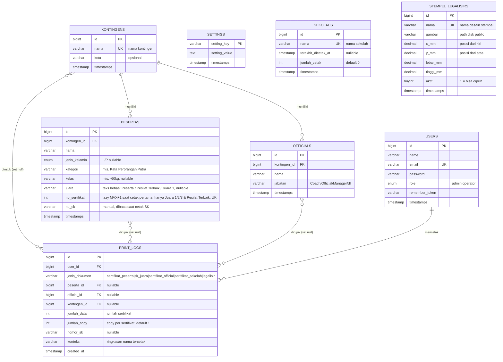

# DB SCHEMA — Sistem Cetak Sertifikat Kejuaraan (SCS)

| Field | Nilai |
|---|---|
| DBMS | MySQL 8.x / MariaDB 10.11+ |
| Engine | InnoDB (semua tabel) |
| Charset | `utf8mb4`, collation `utf8mb4_unicode_ci` |
| Version | 1.6 |
| Tanggal | 28 Oktober 2026 |
| Terkait | `INDEX.md`, `PRD.md`, `TRD.md`, `LEGALISIR_PLAN.md` |

---

## 1. ERD



> **Keputusan desain:** identitas kejuaraan (nama, penyelenggara, tanggal, logo, dll.) TIDAK dibuat tabel terpisah, melainkan disimpan di `settings` (key-value), karena asumsi biznis: satu instalan = satu kejuaraan aktif (PRD §8/§10).
> **Keputusan penomoran:** `no_sertifikat` dibuat **lazy** di kolom `pesertas` (MAX+1 saat cetak pertama, dipakai ulang bila sudah ada — tanpa tabel counter); hanya **Juara 1/2/3 dan Pesilat Terbaik** yang berhak mendapat nomor, sedangkan label **Peserta** tidak (nomor lama dikosongkan oleh migrasi `2026_10_23_000009`). `no_sk` diinput manual panitia di baris peserta. Cetak bisa satuan maupun bulk; **satu peserta = satu halaman SK**, `no_sk` hanya label dan boleh kosong. Di `/cetak`, juara 1/2/3 & Pesilat Terbaik mengalokasikan nomor MAX+1; label **Peserta** tetap dicetak tanpa nomor (`NULL`).
>
> **Keputusan legalisir:** stempel disimpan terpisah di `stempel_legalisirs` (satu desain = satu posisi tetap, tanpa relasi ke peserta); `print_logs.jumlah_copy` mencatat copy per sertifikat sehingga total halaman = `jumlah_data × jumlah_copy`.

---

## 2. DDL Lengkap

### 2.1 `users` — akun panitia

```sql
CREATE TABLE `users` (
  `id`             BIGINT UNSIGNED NOT NULL AUTO_INCREMENT,
  `name`           VARCHAR(100)    NOT NULL,
  `email`          VARCHAR(150)    NOT NULL,
  `email_verified_at`      TIMESTAMP NULL DEFAULT NULL,
  `password`       VARCHAR(255)    NOT NULL,
  `role`           ENUM('admin','operator') NOT NULL DEFAULT 'operator',
  `remember_token` VARCHAR(100)    NULL,
  `created_at`     TIMESTAMP NULL DEFAULT NULL,
  `updated_at`     TIMESTAMP NULL DEFAULT NULL,
  PRIMARY KEY (`id`),
  UNIQUE KEY `users_email_unique` (`email`)
) ENGINE=InnoDB DEFAULT CHARSET=utf8mb4 COLLATE=utf8mb4_unicode_ci;
```

### 2.2 `kontingens` — kontingen/tim/daerah peserta

```sql
CREATE TABLE `kontingens` (
  `id`         BIGINT UNSIGNED NOT NULL AUTO_INCREMENT,
  `nama`       VARCHAR(150)    NOT NULL,
  `kota`       VARCHAR(100)    NULL,
  `created_at` TIMESTAMP NULL DEFAULT NULL,
  `updated_at` TIMESTAMP NULL DEFAULT NULL,
  PRIMARY KEY (`id`),
  UNIQUE KEY `kontingens_nama_unique` (`nama`)
) ENGINE=InnoDB DEFAULT CHARSET=utf8mb4 COLLATE=utf8mb4_unicode_ci;
```

### 2.3 `pesertas` — peserta lomba (baris = 1 orang dalam 1 kategori)

```sql
CREATE TABLE `pesertas` (
  `id`            BIGINT UNSIGNED NOT NULL AUTO_INCREMENT,
  `kontingen_id`  BIGINT UNSIGNED NOT NULL,
  `nama`          VARCHAR(150)    NOT NULL,
  `jenis_kelamin` ENUM('L','P')   NULL DEFAULT NULL,
  `kategori`      VARCHAR(120)    NOT NULL,   -- mis. 'Kata Perorangan Putra'
  `kelas`         VARCHAR(120)    NULL,       -- mis. '-60 kg', 'Sabuk Hitam'
  `kelompok_usia` VARCHAR(40)     NULL,       -- Pra Usia Dini | Usia Dini 1 | Usia Dini 2 | Pra Remaja | Remaja | Dewasa
  `juara`         VARCHAR(100)    NULL,       -- teks bebas: 'Peserta', 'Pesilat Terbaik', 'Juara 1', '1'/'2'/'3' (lama)
  `no_sertifikat` INT UNSIGNED    NULL,       -- lazy assignment saat cetak pertama (MAX+1); hanya Juara 1/2/3 & Pesilat Terbaik
  `no_sk`         VARCHAR(100)    NULL,       -- nomor SK diinput manual panitia, dibaca saat cetak SK
  `created_at`    TIMESTAMP NULL DEFAULT NULL,
  `updated_at`    TIMESTAMP NULL DEFAULT NULL,
  PRIMARY KEY (`id`),
  UNIQUE KEY `pesertas_no_sertifikat_unique` (`no_sertifikat`),
  KEY `pesertas_kontingen_id_index` (`kontingen_id`),
  KEY `pesertas_kategori_index` (`kategori`),
  KEY `pesertas_juara_index` (`juara`),
  CONSTRAINT `pesertas_kontingen_foreign`
    FOREIGN KEY (`kontingen_id`) REFERENCES `kontingens` (`id`)
    ON DELETE CASCADE ON UPDATE CASCADE
) ENGINE=InnoDB DEFAULT CHARSET=utf8mb4 COLLATE=utf8mb4_unicode_ci;
```

> **Catatan normalisasi (disengaja):** jika satu orang mengikuti 2 kategori → **2 baris** dengan `nama` sama. Ini menyederhanakan CRUD dan pencetakan (PRD §8 aturan 2). Duplikasi nama diterima karena baris mewakili kepesertaan, bukan entitas orang.

### 2.4 `officials` — coach / official / manager kontingen

```sql
CREATE TABLE `officials` (
  `id`           BIGINT UNSIGNED NOT NULL AUTO_INCREMENT,
  `kontingen_id` BIGINT UNSIGNED NOT NULL,
  `nama`         VARCHAR(150)    NOT NULL,
  `jabatan`      VARCHAR(60)     NOT NULL DEFAULT 'Coach',  -- Coach | Official | Manager | Dokter | Lainnya
  `created_at`   TIMESTAMP NULL DEFAULT NULL,
  `updated_at`   TIMESTAMP NULL DEFAULT NULL,
  PRIMARY KEY (`id`),
  KEY `officials_kontingen_id_index` (`kontingen_id`),
  CONSTRAINT `officials_kontingen_foreign`
    FOREIGN KEY (`kontingen_id`) REFERENCES `kontingens` (`id`)
    ON DELETE CASCADE ON UPDATE CASCADE
) ENGINE=InnoDB DEFAULT CHARSET=utf8mb4 COLLATE=utf8mb4_unicode_ci;
```

> `jabatan` varchar (bukan ENUM) agar mudah menambah label tanpa migrasi; daftar opsi cukup dikunci di dropdown Blade.

### 2.5 `settings` — konfigurasi dokumen (key-value)

```sql
CREATE TABLE `settings` (
  `setting_key`   VARCHAR(100) NOT NULL,
  `setting_value` TEXT         NULL,
  `created_at`    TIMESTAMP NULL DEFAULT NULL,
  `updated_at`    TIMESTAMP NULL DEFAULT NULL,
  PRIMARY KEY (`setting_key`)
) ENGINE=InnoDB DEFAULT CHARSET=utf8mb4 COLLATE=utf8mb4_unicode_ci;
```

**Key yang digunakan aplikasi (seed wajib):**

| `setting_key` | Contoh nilai | Dipakai untuk |
|---|---|---|
| `nama_kejuaraan` | `Kejuaraan Karate Kabupaten X 2026` | kop sertifikat & SK |
| `singkatan_kejuaraan` | `SKX26` | label kecil di kop dokumen |
| `penyelenggara` | `DPD Karate Kabupaten X` | kop |
| `tempat_tanggal` | `Gelanggang Olahraga X, 10-12 Maret 2026` | kop |
| `logo_kiri` | `public/dokumen/logo-kiri.png` | kop dokumen |
| `logo_kanan` | `public/dokumen/logo-kanan.png` | kop dokumen |
| `background_sertifikat` | `public/dokumen/bg-sertifikat.png` | full-bleed latar sertifikat (A4 landscape) |
| `teks_sertifikat` | `"Diberikan kepada {NAMA} atas prestasinya sebagai JUARA {JUARA_ROMAWI} ({KATEGORI}{KELAS}) mewakili {KONTINGEN}. No. {NOMOR_SERTIFIKAT}."` | isi sertifikat peserta |
| `teks_sertifikat_official` | `"Diberikan kepada {NAMA} selaku {JABATAN} kontingen {KONTINGEN}."` | isi sertifikat official |
| `nama_ttd` | `H. Ahmad Wijaya, S.Pd` | blok penandatangan |
| `jabatan_ttd` | `Ketua Panitia` | blok penandatangan |
| `kota_ttd` | `X` | "Ditetapkan di …" |
| `varian_pemasalan` | `Pra Usia Dini, Usia Dini 1` | penentuan varian teks otomatis |
| `legalisir_jumlah_copy` | `2` | copy per sertifikat legalisir (1–20) |

Placeholder yang didukung: `{NOMOR_SERTIFIKAT}`, `{NAMA}`, `{JUARA_ANGKA}`, `{JUARA_ROMAWI}`, `{KATEGORI}`, `{KELAS}`, `{KONTINGEN}`, `{JABATAN}`. Nomor SK tidak digenerate sistem — ditulis langsung dari `pesertas.no_sk`.

### 2.6 `print_logs` — audit cetak

```sql
CREATE TABLE `print_logs` (
  `id`            BIGINT UNSIGNED NOT NULL AUTO_INCREMENT,
  `user_id`       BIGINT UNSIGNED NULL,   -- NULL = cetak tanpa login (tamu)
  `jenis_dokumen` VARCHAR(40) NOT NULL,  -- sertifikat_peserta | sk_juara | sertifikat_official | sertifikat_sekolah | legalisir
  `peserta_id`    BIGINT UNSIGNED NULL,   -- hanya diisi bila cetak 1 peserta
  `official_id`   BIGINT UNSIGNED NULL,   -- hanya diisi bila cetak 1 official
  `kontingen_id`  BIGINT UNSIGNED NULL,   -- denormalisasi untuk filter riwayat per kontingen
  `jumlah_data`   INT UNSIGNED    NOT NULL DEFAULT 1,  -- jumlah sertifikat/peserta dalam PDF
  `jumlah_copy`   INT UNSIGNED    NOT NULL DEFAULT 1,  -- copy per sertifikat; total halaman = jumlah_data × jumlah_copy
  `nomor_sk`      VARCHAR(100)    NULL,   -- diisi jika jenis = sk_juara
  `konteks`       VARCHAR(500)    NULL,   -- ringkasan: nama-nama yang tercetak
  `created_at`    TIMESTAMP NULL DEFAULT NULL,  -- WIB (Asia/Jakarta)
  PRIMARY KEY (`id`),
  KEY `print_logs_user_id_index` (`user_id`),
  KEY `print_logs_created_at_index` (`created_at`),
  KEY `print_logs_jenis_index` (`jenis_dokumen`),
  CONSTRAINT `print_logs_user_foreign`
    FOREIGN KEY (`user_id`) REFERENCES `users` (`id`) ON DELETE CASCADE,
  CONSTRAINT `print_logs_peserta_foreign`
    FOREIGN KEY (`peserta_id`) REFERENCES `pesertas` (`id`) ON DELETE SET NULL,
  CONSTRAINT `print_logs_official_foreign`
    FOREIGN KEY (`official_id`) REFERENCES `officials` (`id`) ON DELETE SET NULL,
  CONSTRAINT `print_logs_kontingen_foreign`
    FOREIGN KEY (`kontingen_id`) REFERENCES `kontingens` (`id`) ON DELETE SET NULL
) ENGINE=InnoDB DEFAULT CHARSET=utf8mb4 COLLATE=utf8mb4_unicode_ci;
```

> Riwayat cetak **tidak boleh dihapus dari UI** (kebutuhan audit PRD FR-09); tabel punya FK `SET NULL` dari sisi data yang bisa terhapus. Kolom `user_id` boleh NULL untuk mencatat **cetak tamu** (tanpa login).

### 2.7 `blangkos` — blangko (gambar kanvas / file Blade)

```sql
CREATE TABLE `blangkos` (
  `id`         BIGINT UNSIGNED NOT NULL AUTO_INCREMENT,
  `nama`       VARCHAR(150)    NOT NULL,
  `jenis`      VARCHAR(30) NOT NULL DEFAULT 'sertifikat',  -- sertifikat | sk | sertifikat_sekolah
  `mode`       ENUM('canvas','blade') NOT NULL DEFAULT 'canvas',
  `view_blade` VARCHAR(120)    NULL,       -- mis. 'blangko.contoh-sertifikat' (hanya mode blade)
  `ukuran_kertas` ENUM('a4','f4','letter','custom') NOT NULL DEFAULT 'a4',
  `gambar`     VARCHAR(255)    NULL,       -- path relatif di storage/app/public (hanya mode canvas)
  `orientasi`  ENUM('landscape','portrait') NOT NULL DEFAULT 'landscape',
  `lebar_mm`   SMALLINT UNSIGNED NOT NULL DEFAULT 297,
  `tinggi_mm`  SMALLINT UNSIGNED NOT NULL DEFAULT 210,
  `aktif`      TINYINT(1)      NOT NULL DEFAULT 1,
  `created_at` TIMESTAMP NULL DEFAULT NULL,
  `updated_at` TIMESTAMP NULL DEFAULT NULL,
  PRIMARY KEY (`id`),
  KEY `blangkos_jenis_aktif_index` (`jenis`, `aktif`)
) ENGINE=InnoDB DEFAULT CHARSET=utf8mb4 COLLATE=utf8mb4_unicode_ci;
```

> `mode` = `canvas` memakai `gambar` + baris `blangko_elemen`; `mode` = `blade` memakai file `.blade.php` yang dirujuk `view_blade` (dipindai dari `resources/views/blangko/`). Saat mode `canvas`, `view_blade` disimpan `NULL`; template divalidasi harus berada di folder tersebut.
>
> `ukuran_kertas` menentukan ukuran halaman: `a4` (210×297 mm), `f4` (215×330 mm), `letter` (216×279 mm), atau `custom`. Nilai `lebar_mm`/`tinggi_mm` **dihitung sistem** dari ukuran + orientasi (landscape menukar lebar/tinggi); untuk `custom` diisi manual. Ukuran inilah yang dipakai `@page` DOMPDF, baik mode kanvas maupun Blade.

### 2.8 `blangko_elemen` — kotak teks di atas gambar blangko

```sql
CREATE TABLE `blangko_elemen` (
  `id`           BIGINT UNSIGNED NOT NULL AUTO_INCREMENT,
  `blangko_id`   BIGINT UNSIGNED NOT NULL,
  `label`        VARCHAR(100)    NOT NULL,   -- nama elemen di panel editor
  `tipe`         ENUM('teks','data','varian','tabel') NOT NULL DEFAULT 'teks',
  `x_mm`         SMALLINT UNSIGNED NOT NULL DEFAULT 0,   -- posisi dari kiri
  `y_mm`         SMALLINT UNSIGNED NOT NULL DEFAULT 0,   -- posisi dari atas
  `lebar_mm`     SMALLINT UNSIGNED NOT NULL DEFAULT 80,
  `tinggi_mm`    SMALLINT UNSIGNED NOT NULL DEFAULT 10,
  `isi`          TEXT            NULL,     -- teks bebas (tipe 'teks')
  `sumber_field` VARCHAR(50)     NULL,     -- kolom data (tipe 'data')
  `varian_key`   VARCHAR(50)     NULL,     -- kunci varian (tipe 'varian')
  `font_family`  VARCHAR(30)     NOT NULL DEFAULT 'sans',  -- sans | serif | mono
  `font_size`    SMALLINT UNSIGNED NOT NULL DEFAULT 11,   -- pt
  `tebal`        TINYINT(1)      NOT NULL DEFAULT 0,
  `miring`       TINYINT(1)      NOT NULL DEFAULT 0,
  `align`        VARCHAR(10)     NOT NULL DEFAULT 'left',  -- left|center|right|justify
  `valign`       VARCHAR(10)     NOT NULL DEFAULT 'top',   -- top|middle|bottom
  `warna`        VARCHAR(20)     NOT NULL DEFAULT '#0f172a',
  `z_index`      SMALLINT UNSIGNED NOT NULL DEFAULT 10,
  `tampil`       TINYINT(1)      NOT NULL DEFAULT 1,
  `created_at`   TIMESTAMP NULL DEFAULT NULL,
  `updated_at`   TIMESTAMP NULL DEFAULT NULL,
  PRIMARY KEY (`id`),
  KEY `blangko_elemen_blangko_id_index` (`blangko_id`),
  CONSTRAINT `blangko_elemen_blangko_foreign`
    FOREIGN KEY (`blangko_id`) REFERENCES `blangkos` (`id`) ON DELETE CASCADE
) ENGINE=InnoDB DEFAULT CHARSET=utf8mb4 COLLATE=utf8mb4_unicode_ci;
```

> **Catatan:** nama tabel disetel manual di model (`protected $table = 'blangko_elemen'`) karena pluralisasi otomatis Laravel mengubah "elemen" → "elemens".

### 2.9 `teks_varians` — varian isi teks pada satu blangko

```sql
CREATE TABLE `teks_varians` (
  `id`         BIGINT UNSIGNED NOT NULL AUTO_INCREMENT,
  `blangko_id` BIGINT UNSIGNED NOT NULL,
  `key`        VARCHAR(50)     NOT NULL,   -- mis. 'prestasi', 'pemasalan'
  `judul`      VARCHAR(100)    NOT NULL,
  `isi`        TEXT            NOT NULL,  -- boleh memakai {NAMA}, {KONTINGEN}, dll.
  `created_at` TIMESTAMP NULL DEFAULT NULL,
  `updated_at` TIMESTAMP NULL DEFAULT NULL,
  PRIMARY KEY (`id`),
  UNIQUE KEY `teks_variants_blangko_id_key_unique` (`blangko_id`, `key`),
  CONSTRAINT `teks_varians_blangko_foreign`
    FOREIGN KEY (`blangko_id`) REFERENCES `blangkos` (`id`) ON DELETE CASCADE
) ENGINE=InnoDB DEFAULT CHARSET=utf8mb4 COLLATE=utf8mb4_unicode_ci;
```

> **Contoh isi varian:**
> - `prestasi` → "Diberikan kepada {NAMA} atas prestasinya sebagai JUARA {JUARA_ROMAWI} pada {KATEGORI} kelompok usia {KELOMPOK_USIA} mewakili {KONTINGEN}."
> - `pemasalan` → "Diberikan kepada {NAMA} atas pembelian merchande pada {NAMA_KEJUARAAN}."

### 2.10 `sekolahs` — daftar sekolah penerima sertifikat ucapan terima kasih

```sql
CREATE TABLE `sekolahs` (
  `id`                  BIGINT UNSIGNED NOT NULL AUTO_INCREMENT,
  `nama`                VARCHAR(150)    NOT NULL,
  `terakhir_dicetak_at` TIMESTAMP       NULL DEFAULT NULL,
  `jumlah_cetak`        INT UNSIGNED    NOT NULL DEFAULT 0,
  `created_at`          TIMESTAMP       NULL DEFAULT NULL,
  `updated_at`          TIMESTAMP       NULL DEFAULT NULL,
  PRIMARY KEY (`id`),
  UNIQUE KEY `sekolahs_nama_unique` (`nama`)
) ENGINE=InnoDB DEFAULT CHARSET=utf8mb4 COLLATE=utf8mb4_unicode_ci;
```

> Sertifikat sekolah **tidak memiliki nomor sertifikat**. `terakhir_dicetak_at` dan `jumlah_cetak` diperbarui setiap kali admin mencetak dari `/sekolah`; `print_logs` mencatat `jenis_dokumen = 'sertifikat_sekolah'` dan `konteks = nama sekolah`.

### 2.11 `stempel_legalisirs` — desain & posisi stempel legalisir

```sql
CREATE TABLE `stempel_legalisirs` (
  `id`         BIGINT UNSIGNED NOT NULL AUTO_INCREMENT,
  `nama`       VARCHAR(150)    NOT NULL,   -- nama desain, unik
  `gambar`     VARCHAR(255)    NOT NULL,   -- path relatif di storage/app/public (mis. stempel-legalisir/xxx.png)
  `x_mm`       DECIMAL(6,2)    NOT NULL DEFAULT 237.00,  -- posisi dari kiri halaman
  `y_mm`       DECIMAL(6,2)    NOT NULL DEFAULT 20.00,   -- posisi dari atas halaman
  `lebar_mm`   DECIMAL(6,2)    NOT NULL DEFAULT 40.00,
  `tinggi_mm`  DECIMAL(6,2)    NOT NULL DEFAULT 40.00,
  `aktif`      TINYINT(1)      NOT NULL DEFAULT 1,
  `created_at` TIMESTAMP       NULL DEFAULT NULL,
  `updated_at` TIMESTAMP       NULL DEFAULT NULL,
  PRIMARY KEY (`id`),
  UNIQUE KEY `stempel_legalisirs_nama_unique` (`nama`),
  KEY `stempel_legalisirs_aktif_index` (`aktif`)
) ENGINE=InnoDB DEFAULT CHARSET=utf8mb4 COLLATE=utf8mb4_unicode_ci;
```

> **Satu desain = satu posisi.** Tidak ada relasi ke peserta atau log; posisi divalidasi aplikasi terhadap ukuran blangko peserta aktif (fallback 297 × 210 mm). Hanya stempel `aktif` yang muncul di halaman legalisir dan lolos validasi cetak. Gambar disimpan di disk `public` folder `stempel-legalisir/`; PNG transparan disarankan. Satu sertifikat memakai tepat satu stempel.

---

## 3. Aturan Integritas Ringkas

| Relasi | ON DELETE | ON UPDATE | Alasan |
|---|---|---|---|
| pesertas → kontingens | CASCADE | CASCADE | Data anak ikut kontingen (konfirmasi di UI sebelum hapus) |
| officials → kontingens | CASCADE | CASCADE | idem |
| print_logs → users | SET NULL | CASCADE | Log tetap ada walau akun dihapus; NULL = cetak tamu |
| blangko_elemen → blangkos | CASCADE | CASCADE | Elemen ikut terhapus bersama blangkonya |
| teks_varians → blangkos | CASCADE | CASCADE | Varian ikut terhapus bersama blangkonya |
| print_logs → pesertas / officials / kontingens | SET NULL | CASCADE | Log tetap ada walau subjek dihapus |
| settings | tanpa FK | — | Key-value standalone |
| sekolahs | tanpa FK | — | Daftar sekolah standalone; nama UNIQUE |
| stempel_legalisirs | tanpa FK | — | Desain stempel standalone; posisi divalidasi aplikasi terhadap ukuran halaman |
| print_logs.jumlah_copy | — | — | Default 1; total halaman dihitung aplikasi (`jumlah_data × jumlah_copy`) |
| pesertas.no_sertifikat | UNIQUE | — | Anti nomor ganda saat lazy-assign paralel |
| pesertas.juara | VARCHAR(100) NULL, tanpa CHECK | — | Teks bebas: `Peserta`, `Pesilat Terbaik`, `Juara 1`, atau nilai lama `1`/`2`/`3` |

---

## 4. Index & Query Utama

| Kebutuhan (FR) | Query |
|---|---|
| Daftar peserta + filter (FR-05) | `SELECT p.*, k.nama AS kontingen_nama FROM pesertas p JOIN kontingens k ON k.id=p.kontingen_id WHERE (...) ORDER BY p.kategori, p.juara, p.nama` |
| Dashboard hitungan (FR-02) | `SELECT COUNT(*) FROM pesertas WHERE juara=1` dsb. (index `juara`, `kategori`); label teks dihitung via `WHERE juara IS NOT NULL` |
| Dropdown kontingen (FR-04/FR-08) | `SELECT id, nama FROM kontingens ORDER BY nama` (PK ter-cover, imun ke ukuran) |
| Riwayat cetak (FR-09) | `SELECT pl.*, u.name FROM print_logs pl JOIN users u ON u.id=pl.user_id ORDER BY pl.created_at DESC` |
| Daftar sekolah + status cetak (FR-18) | `SELECT * FROM sekolahs ORDER BY terakhir_dicetak_at IS NULL, terakhir_dicetak_at DESC, nama` |
| Pilihan stempel legalisir (FR-19) | `SELECT * FROM stempel_legalisirs WHERE aktif=1 ORDER BY nama` (index `aktif`) |
| Riwayat legalisir + total halaman (FR-19) | `SELECT *, jumlah_data*jumlah_copy AS total_halaman FROM print_logs WHERE jenis_dokumen='legalisir'` |
| Penomoran sertifikat (FR-06) | transaksi + `GET_LOCK('scs_no_sertifikat')` + `SELECT MAX(no_sertifikat) FROM pesertas` |

Semua filter kolom sudah diindex (`nama` kontingen unique, `kategori`, `juara`, `no_sertifikat` UNIQUE, `created_at` log).

---

## 5. Mapping ke Migrasi Laravel

Struktur file migrasi (**sudah terimplementasi** di repo, urutan sesuai FK):

```
database/migrations/
 0001_01_01_000000_create_users_table.php            (bawaan Laravel: users, password_reset_tokens, sessions)
 0001_01_01_000001_create_cache_table.php             (bawaan Laravel)
 0001_01_01_000002_create_jobs_table.php              (bawaan Laravel)
 2026_10_22_000001_add_role_to_users_table.php        (kolom users.role)
 2026_10_22_000002_create_kontingens_table.php
 2026_10_22_000003_create_pesertas_table.php
 2026_10_22_000004_create_officials_table.php
 2026_10_22_000005_create_settings_table.php
 2026_10_22_000006_create_print_logs_table.php
 2026_10_23_000001_add_kelompok_usia_to_pesertas_table.php
 2026_10_23_000002_make_print_logs_user_id_nullable.php
 2026_10_23_000003_create_blangkos_table.php
 2026_10_23_000004_create_blangko_elemen_table.php
 2026_10_23_000005_create_teks_varians_table.php
  2026_10_23_000006_add_mode_to_blangkos_table.php      (kolom blangkos.mode & view_blade)
  2026_10_23_000007_add_ukuran_kertas_to_blangkos_table.php (kolom blangkos.ukuran_kertas)
  2026_10_23_000008_change_juara_to_text_on_pesertas_table.php (juara VARCHAR(100))
  2026_10_23_000009_null_no_sertifikat_for_peserta_label.php   (kosongkan nomor label Peserta)
  2026_10_23_000010_shift_print_log_timestamps_to_wib.php      (log lama UTC → WIB)
  2026_10_27_000001_create_sekolahs_table.php                  (tabel sekolahs)
  2026_10_27_000002_add_sertifikat_sekolah_types.php           (jenis blangko & log jadi VARCHAR + sertifikat_sekolah)
  2026_10_28_000001_create_stempel_legalisirs_table.php        (tabel stempel_legalisirs)
  2026_10_28_000002_add_jumlah_copy_to_print_logs_table.php    (kolom print_logs.jumlah_copy)
```

Contoh migrasi `pesertas` (idem pola untuk tabel lain):

```php
public function up(): void
{
    Schema::create('pesertas', function (Blueprint $table) {
        $table->id();
        $table->foreignId('kontingen_id')->constrained('kontingens')->cascadeOnDelete();
        $table->string('nama', 150);
        $table->enum('jenis_kelamin', ['L', 'P'])->nullable();
        $table->string('kategori', 120);
        $table->string('kelas', 120)->nullable();
        $table->string('juara', 100)->nullable();   // teks bebas, tanpa CHECK
        $table->unsignedInteger('no_sertifikat')->nullable();
        $table->string('no_sk', 100)->nullable();
        $table->timestamps();

        $table->unique('no_sertifikat');
        $table->index('kategori');
        $table->index('juara');
    });
}
```

> **Perubahan 23 Oktober 2026:** migrasi `2026_10_23_000008_change_juara_to_text_on_pesertas_table` mengubah `juara` menjadi `VARCHAR(100)` dan menghapus `pesertas_juara_check`. Nilai lama `1`/`2`/`3` tetap dibaca sebagai Emas/Perak/Perunggu oleh `Peserta::labelJuara()`.

`$fillable` (mass-assignment aman):

```php
// Peserta
protected $fillable = ['kontingen_id','nama','jenis_kelamin','kategori','kelas','juara','no_sertifikat','no_sk'];

// Official
protected $fillable = ['kontingen_id','nama','jabatan'];

// Setting
protected $primaryKey = 'setting_key';
public $incrementing = false;
protected $keyType = 'string';
protected $fillable = ['setting_key','setting_value'];

// PrintLog
protected $fillable = ['user_id','jenis_dokumen','peserta_id','official_id',
                       'kontingen_id','jumlah_data','jumlah_copy','nomor_sk','konteks'];

// Sekolah
protected $table = 'sekolahs';
protected $fillable = ['nama','terakhir_dicetak_at','jumlah_cetak'];

// StempelLegalisir
protected $fillable = ['nama','gambar','x_mm','y_mm','lebar_mm','tinggi_mm','aktif'];
```

---

## 6. Seed Data (basic)

```sql
-- users (password di-hash oleh seeder: Hash::make('password'))
INSERT INTO users (name, email, password, role) VALUES
('Admin Kejuaraan', 'admin@sistem.test', '<HASH>', 'admin'),
('Operator 1',      'operator@sistem.test', '<HASH>', 'operator');

-- kontingens
INSERT INTO kontingens (nama, kota) VALUES
('Kontingen Sumbermaneg', 'Kab. X'),
('Kontingen Putra Darma', 'Kab. Y'),
('Kontingen Garuda', 'Kota Z');

-- pesertas (no_sertifikat NULL = belum punya nomor; lazy-assign saat cetak untuk Juara 1/2/3 & Pesilat Terbaik)
INSERT INTO pesertas (kontingen_id, nama, jenis_kelamin, kategori, kelas, juara, no_sertifikat, no_sk) VALUES
(1, 'Muhammad Rizky',  'L', 'Kata Perorangan Putra', NULL, 1, 1, '001/SK/SKX26/III/2026'),
(1, 'Andi Saputra',    'L', 'Kumite -60 kg Putra',   '-60 kg', 2, 2, '001/SK/SKX26/III/2026'),
(2, 'Salsabila Putri', 'P', 'Kata Perorangan Putri', NULL, 1, NULL, '002/SK/SKX26/III/2026'),
(2, 'Nadia Kirana',    'P', 'Kumite -50 kg Putri',   '-50 kg', 3, 3, '002/SK/SKX26/III/2026'),
(3, 'Febriyansyah',    'L', 'Kumite -70 kg Putra',   '-70 kg', NULL, NULL, NULL);

-- officials
INSERT INTO officials (kontingen_id, nama, jabatan) VALUES
(1, 'Coach Budi Hartono',  'Coach'),
(2, 'Coach Darmawan',      'Coach'),
(2, 'Pak Joko Wibisono',   'Official');

-- settings
INSERT INTO settings (setting_key, setting_value) VALUES
('nama_kejuaraan', 'Kejuaraan Karate Kabupaten X 2026'),
('singkatan_kejuaraan', 'SKX26'),
('penyelenggara', 'DPD Karate Kabupaten X'),
('tempat_tanggal', 'GOR Kabupaten X, 10-12 Maret 2026'),
('teks_sertifikat', 'Diberikan kepada {NAMA} atas prestasinya sebagai JUARA {JUARA_ROMAWI} pada {KATEGORI}{KELAS} mewakili {KONTINGEN}. No. {NOMOR_SERTIFIKAT}.'),
('teks_sertifikat_official', 'Diberikan kepada {NAMA} selaku {JABATAN} Kontingen {KONTINGEN}.'),
('nama_ttd', 'H. Ahmad Wijaya, S.Pd'),
('jabatan_ttd', 'Ketua Panitia'),
('kota_ttd', 'X'),
('varian_pemasalan', 'Pra Usia Dini, Usia Dini 1'),
('legalisir_jumlah_copy', '2');
```

> Seeder Laravel: `AdminSeeder`, `SettingsSeeder` (wajib — aplikasi tidak boleh crash ketika key settings belum ada; helper `Setting::get($key, $default)` dengan fallback), `DemoSeeder` untuk data demo.

---

## 7. Pertumbuhan Data & Pemeliharaan

| Aspek | Perkiraan | Catatan |
|---|---|---|
| Baris pesertas | 500–5.000 / kejuaraan | Full-scan tetap cepat < 1 detik dengan index |
| Baris print_logs | ~ jumlah lembar tercetak × 1 | Dianjurkan arsip per tahun (DELETE manual via tinker saat reset musiman, bukan dari UI) |
| Baris stempel_legalisirs | < 50 / event | Desain stempel jarang berubah; gambar di `storage/app/public/stempel-legalisir` |
| Cache grayscale | `storage/app/legalisir` | Runtime-only; aman dihapus, dibuat ulang saat cetak |
| Backup | `mysqldump` + copy `storage/app/public` | Sebelum event dan tiap akhir hari event |
| Reset tahunan | TRUNCATE `pesertas`,`officials`,`print_logs`, update `settings` (nomor sertifikat otomatis mulai dari 1 lagi karena tabel kosong) | Fitur reset di UI = item M3 PRD |

---

## 8. Pertanyaan Terbuka Terkait Skema

1. Apakah perlu kolom `no_urut_panggilan` atau `no_pertandingan` di `pesertas` untuk listing SK berurutan panggilan?
2. Apakah perlu tabel `kejuaraans` bila di masa depan satu install menampung multi-event (agar skema tetap kompatibel)?
3. Apakah ada kebutuhan sertifikat official **tanpa kontingen** (mis. official generik "Dewan Hakim")? Skema saat ini mewajibkan `kontingen_id`, sesuai flow user (dropdown dari kontingen terdaftar).

---

## 9. Status Implementasi Skema (28 Oktober 2026)

| Tabel | Status | Catatan implementasi |
|---|---|---|
| `users` | ✅ Terbuat | Kolom `role` ENUM('admin','operator') ditambahkan lewat migrasi terpisah (`add_role_to_users_table`) |
| `kontingens` | ✅ Terbuat | `nama` UNIQUE; relasi `CASCADE` ke pesertas & officials |
| `pesertas` | ✅ Terbuat | Termasuk `no_sertifikat` UNIQUE (dipakai lazy saat cetak admin/tamu untuk Juara 1/2/3 & Pesilat Terbaik, sedangkan label Peserta tetap `NULL` lewat migrasi `2026_10_23_000009`) + `no_sk` (manual, hanya label nomor SK; bukan pengelompokan karena satu peserta = satu halaman); `juara` kini **VARCHAR(100) teks bebas** (migrasi `2026_10_23_000008`), nilai lama `1`/`2`/`3` tetap dipetakan ke label Emas/Perak/Perunggu |
| `officials` | ✅ Terbuat & terpakai | Data demo ter-seed; form official + sertifikat official aktif (P3) |
| `settings` | ✅ Terbuat | Key default ter-seed (`SettingsSeeder`), termasuk `varian_pemasalan` dan `legalisir_jumlah_copy`; key `nomor_sk_format` **dihapus** sesuai keputusan K5; kini aktif dipakai (identitas, logo, background, template teks, copy legalisir) |
| `print_logs` | ✅ Terbuat & terpakai | Setiap aksi cetak (sertifikat peserta / SK / sertifikat official / **sertifikat sekolah** / **legalisir**) tercatat: user, jenis, subjek, jumlah, **copy**, nomor SK, ringkasan nama. `jenis_dokumen` kini **VARCHAR(40)** (migrasi `2026_10_27_000002`), bukan ENUM; `jumlah_copy` ditambahkan migrasi `2026_10_28_000002` (default 1); `user_id` **nullable** untuk mencatat cetak tamu (tanpa login); timestamp memakai **WIB** (`Asia/Jakarta`), log lama UTC digeser +7 jam oleh migrasi `2026_10_23_000010` |
| `blangkos` | ✅ Terbuat & terpakai | Blangko dua mode (`canvas` / `blade`), jenis **`sertifikat` / `sk` / `sertifikat_sekolah`** (VARCHAR, migrasi `2026_10_27_000002`), ukuran kertas (`a4`/`f4`/`letter`/`custom`), orientasi, status aktif; hanya 1 aktif per jenis. `view_blade` menyimpan nama view template Blade (`NULL` untuk kanvas); `lebar_mm`/`tinggi_mm` diturunkan dari ukuran + orientasi |
| `blangko_elemen` | ✅ Terbuat & terpakai | Kotak teks di atas blangko: posisi/ukuran mm, tipe (teks/data/varian/tabel), gaya; nama tabel disetel manual di model; field data `sekolah` tersedia untuk blangko sekolah |
| `teks_varians` | ✅ Terbuat & terpakai | Varian isi teks per blangko (`prestasi`, `pemasalan`) — dipilih otomatis dari `pesertas.kelompok_usia` |
| `sekolahs` | ✅ Terbuat & terpakai | Daftar sekolah penerima sertifikat ucapan terima kasih: `nama` UNIQUE, `terakhir_dicetak_at`, `jumlah_cetak`; tanpa nomor sertifikat; hanya admin yang mengelola & mencetak |
| `stempel_legalisirs` | ✅ Terbuat & terpakai | Desain stempel legalisir: `nama` UNIQUE, `gambar`, posisi/ukuran mm, `aktif`; satu desain = satu posisi tetap; hanya admin; gambar di disk `public/stempel-legalisir` |

**Seeder aktif:** `AdminSeeder` (akun `admin@sistem.test` & `operator@sistem.test`, password `password`), `SettingsSeeder` (default dokumen + `legalisir_jumlah_copy = 2`), `DemoSeeder` (3 kontingen, 5 peserta — 2 di antaranya belum punya `no_sertifikat` untuk mendemonstrasikan lazy-assign, 3 official). **Jangan jalankan `SettingsSeeder` di database produksi** karena `updateOrCreate` dapat menimpa nilai yang sudah diubah admin; fallback `Setting::getValue('legalisir_jumlah_copy', 2)` sudah cukup.

**Database:** `sistem_cetak_sertifikat` (aplikasi) & `sistem_cetak_sertifikat_test` (uji otomatis, tanpa ekstensi `pdo_sqlite` di mesin ini) — keduanya MySQL 8.0.30 / InnoDB / utf8mb4.
