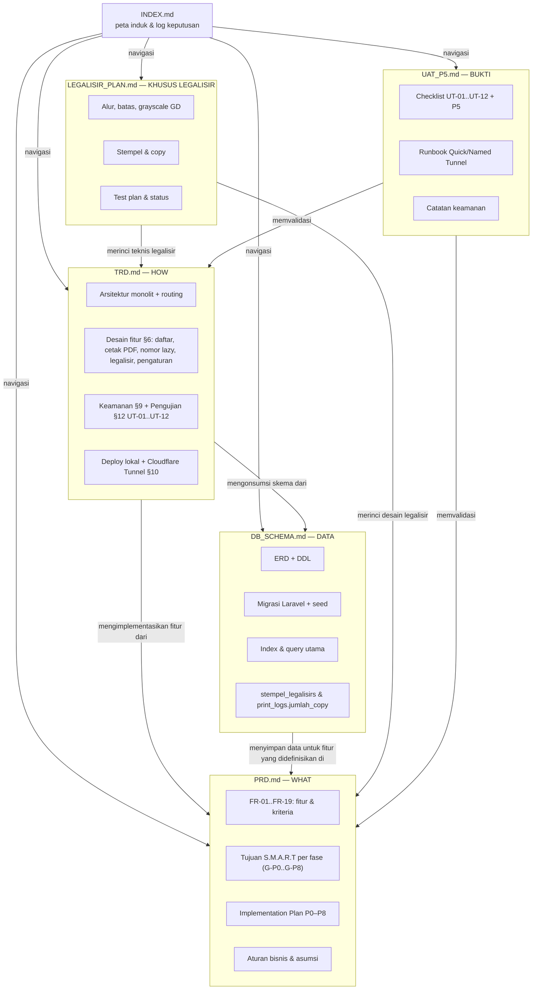

# INDEX — Dokumentasi Sistem Cetak Sertifikat Kejuaraan (SCS)

| Field | Nilai |
|---|---|
| Proyek | Sistem Cetak Sertifikat (SCS) |
| Lokasi Dokumen | `docs/` |
| Terakhir Diperbarui | 28 Oktober 2026 |

Dokumen ini adalah **peta induk** yang merelasikan dokumen spesifikasi dan checklist UAT. Baca dokumen ini dulu, lalu lanjut sesuai kebutuhan peranmu.

---

## 1. Daftar Dokumen

| # | Dokumen | Path | Menjawab Pertanyaan | Isi Utama | Audiens Utama |
|---|---|---|---|---|---|
| 1 | **PRD** — Product Requirements Document | [`docs/PRD.md`](PRD.md) | **APA & KENAPA** dibangun? | Latar belakang, persona, 19 fitur (FR-01–FR-19), alur pengguna, kebutuhan non-fungsional, aturan bisnis, **Tujuan S.M.A.R.T**, **Implementation Plan** | Product owner, panitia, QA |
| 2 | **TRD** — Technical Requirements Document | [`docs/TRD.md`](TRD.md) | **BAGAIMANA** dibangun & dijalankan? | Arsitektur monolit, stack, routing, desain fitur utama (termasuk penomoran sertifikat lazy, sertifikat sekolah, dan legalisir), keamanan, deploy lokal + Cloudflare Tunnel, rencana pengujian | Developer |
| 3 | **DB SCHEMA** | [`docs/DB_SCHEMA.md`](DB_SCHEMA.md) | **DATA-nya seperti apa?** | ERD, DDL tabel utama (termasuk `sekolahs` dan `stempel_legalisirs`), aturan integritas/FK, index, migrasi Laravel, seed data | Developer, DBA |
| 4 | **UAT P5** — Checklist Deploy & Uji Terima | [`docs/UAT_P5.md`](UAT_P5.md) | **Apakah sudah layak dipakai?** | Ringkasan hasil otomatis, checklist UT-01–UT-12, checklist P5, runbook Quick/Named Tunnel, catatan keamanan | Panitia, QA, developer |
| 5 | **LEGALISIR PLAN** — Rencana & Status Fitur Legalisir | [`docs/LEGALISIR_PLAN.md`](LEGALISIR_PLAN.md) | **BAGAIMANA legalisir bekerja & diuji?** | Ruang lingkup, alur, skema `stempel_legalisirs`, setting copy, batas cetak, pendekatan grayscale GD, routing, test plan, status implementasi | Developer, admin, QA |

Semua dokumen berbahasa Indonesia, saling merujuk dengan nama file (mis. `PRD §8`, `TRD §6.5`, `DB §2.3`).

---

## 2. Peta Relasi Dokumen

### 2.1 Relasi Detail: Requirement → Teknis → Data

| Kebutuhan (PRD) | Implementasi (TRD) | Struktur Data (DB_SCHEMA) |
|---|---|---|
| FR-01 Autentikasi, FR-11 Manajemen User | TRD §6.1 auth & gate `admin`, route `/user` | `users` (DB §2.1) |
| FR-03 Kontingen CRUD | TRD §5 route `/kontingen` | `kontingens` (DB §2.2) — induk dari `pesertas` & `officials` |
| FR-04, FR-05 Peserta CRUD + daftar & filter | TRD §6.2 query filter | `pesertas` (DB §2.3) — index kategori/juara |
| FR-06 Cetak Sertifikat (satuan & bulk) | TRD §6.3 + §6.5 (lazy assignment `NomorSertifikat`) | `pesertas.no_sertifikat` (UNIQUE), `print_logs` |
| FR-07 Cetak SK Juara | TRD §6.4 (satu peserta per halaman; `no_sk` opsional) | `pesertas.no_sk`, `print_logs.nomor_sk` |
| FR-08 Sertifikat Official | TRD §6.6 | `officials` (DB §2.4) |
| FR-09 Riwayat Cetak | TRD §5 route `/log` | `print_logs` (DB §2.6) — FK `SET NULL` |
| FR-10 Pengaturan Dokumen | TRD §6.7 | `settings` key-value (DB §2.5) |
| FR-18 Sertifikat Sekolah | TRD §5 route `/sekolah`, §6.10 alur cetak | `sekolahs` (DB §2.10), `print_logs.jenis_dokumen` |
| FR-19 Legalisir Sertifikat Peserta | TRD §5 route `/legalisir`, §6.11 desain legalisir; `LEGALISIR_PLAN.md` | `stempel_legalisirs` (DB §2.11), `print_logs.jumlah_copy` (DB §2.6), setting `legalisir_jumlah_copy` |
| Tujuan S.M.A.R.T per fase (§3, G-P0..G-P8) | Divalidasi per fase: DoD di §11.2 + kasus uji TRD §12 | — |
| Fase P0–P8 (Implementation Plan) | Senjata teknis di TRD §2 (stack), §7 (konfigurasi PDF), §10 (deploy) | Migrasi & seed di DB §5–§6 |

---

## 3. Urutan Membaca yang Disarankan

1. **Semua peran:** halaman ini → `PRD.md` §1–§7 (produk & flow).
2. **Developer (onboarding):** `PRD.md` (Implementation Plan §11) → `DB_SCHEMA.md` (ERD + migrasi) → `TRD.md` (php stack & deploy) → mulai coding fase P0.
3. **QA/Tester:** `PRD.md` (kriteria penerimaan FR) → `TRD.md` §12 (kasus uji) → `UAT_P5.md` (checklist & bukti hasil).
4. **Panitia/user:** cukup `PRD.md` §1, §7 (alur cetak), dan bagian "aturan bisnis" §9.

---

## 4. Log Keputusan Desain (Terkunci)

| # | Keputusan | Rangkuman | Sumber |
|---|---|---|---|
| K1 | Arsitektur monolit, TANPA API | Server-rendered Blade; semua fitur di 1 aplikasi Laravel | PRD §1, TRD §1 |
| K2 | Stack: Laravel + Blade + Tailwind (Vite) + MySQL + DomPDF | Tanpa Breeze/Jetstream & tanpa wkhtmltopdf (mudah di Windows) | TRD §2 |
| K3 | **Mode cetak: keduanya** (satuan & bulk via checkbox multi-select, maks 50/PDF) | Satu path kode; tombol per-baris + select all | PRD FR-06, TRD §5 |
| K4 | **Nomor sertifikat: lazy assignment** | `no_sertifikat` = MAX+1 saat cetak pertama (admin atau tamu) untuk Juara 1/2/3 & Pesilat Terbaik; label Peserta tidak; dipakai ulang bila sudah ada; `GET_LOCK` + UNIQUE | PRD §9.4, TRD §6.5, DB §2.3 |
| K5 | **Nomor SK: manual dari panitia** | Kolom `no_sk` di `pesertas`; cetak SK hanya membaca; batch SK tidak butuh `no_sk`, satu peserta = satu halaman | PRD FR-07, TRD §6.4 |
| K6 | Identitas kejuaraan di `settings` (key-value), bukan tabel kejuaraan | Asumsi 1 install = 1 kejuaraan aktif | DB §1 keputusan desain |
| K7 | Tanpa library PDF eksternal binary; `barryvdh/laravel-dompdf` | Pure PHP → deploy Windows jadi mudah | TRD §2 |
| K8 | Blade PDF (dompdf) pisah dari Blade web (Tailwind) | `resources/views/pdf/**` tidak boleh memakai Tailwind | TRD §3 |
| K9 | Deploy: Laragon/XAMPP lokal + `cloudflared` tunnel (HTTPS publik), `TRUSTED_PROXIES=*` | Tetap berfungsi offline di LAN | TRD §10 |
| K10 | **Legalisir: admin-only, 1 desain stempel = 1 posisi, 1 sertifikat = 1 stempel** | Copy default 2 (1–20); maks 50 peserta & 200 halaman/PDF; hanya sertifikat peserta; memakai blangko peserta aktif | PRD FR-19, TRD §6.11, LEGALISIR_PLAN |
| K11 | **Hitam putih memakai GD + CSS, bukan filter/Imagick** | Gambar lokal dikonversi ke PNG grayscale di cache `storage/app/legalisir`; stempel dikecualikan agar tetap berwarna | TRD §6.11, LEGALISIR_PLAN §5 |

---

## 5. Status Dokumen & Implementasi

| Dokumen | Versi | Status | Catatan |
|---|---|---|---|
| PRD | 1.6 | Draft — menunggu review | Tujuan S.M.A.R.T per fase (§3) & Implementation Plan (§11) sudah ada; **§11.5 memuat status implementasi & bukti validasi**; blangko dua mode (kanvas & Blade) dengan ukuran kertas A4/F4/Letter/Custom; **FR-18 Sertifikat Sekolah**; **FR-19 Legalisir** |
| TRD | 1.6 | Draft | Stack aktual terverifikasi (Laravel 13.17, PHP 8.3.29, MySQL 8.0.30, DomPDF 3.1); **§14 memuat peta file P0–P8**; **§6.9 kontrak template Blade & ukuran kertas**, **§6.10 sertifikat sekolah**, **§6.11 legalisir** |
| DB_SCHEMA | 1.6 | Draft | Semua tabel ter-migrasi di MySQL (termasuk `sekolahs` & `stempel_legalisirs`); **§9 memuat status implementasi skema**; `blangkos.mode`, `view_blade`, `ukuran_kertas`, `blangkos.jenis` & `print_logs.jenis_dokumen` VARCHAR; `print_logs.jumlah_copy` |
| LEGALISIR_PLAN | 1.0 | Selesai | Rencana & status fitur legalisir: skema, alur, batas, grayscale GD, routing, 21 test |
| UAT_P5 | 1.2 | Berjalan — sebagian | Named Tunnel HTTPS `sbcc.my.id` lolos; checklist UT-01–UT-12 & P5, runbook, dan catatan keamanan |

### 5.1 Progres Implementasi Kode

| Fase | Status | Bukti |
|---|---|---|
| **P0 — Setup & Fondasi** | ✅ Selesai | 9 migrasi + seed, DomPDF terverifikasi, `npm run build` OK, MySQL 8.0.30 |
| **P1 — Data Master & Auth** | ✅ Selesai | Login + rate limit, CRUD kontingen & peserta, filter & pencarian (termasuk kelompok usia), cascade hapus |
| **P2 — Cetak Sertifikat** | ✅ Selesai | PDF satuan & bulk, 1 peserta = 1 halaman, nomor lazy (MAX+1 + `GET_LOCK`), dipakai ulang saat cetak ulang, admin bisa memilih Dengan/Tanpa background (tamu selalu Dengan background) |
| **P3 — SK & Official** | ✅ Selesai | SK portrait satu peserta per halaman, modul official (nama + dropdown kontingen) & sertifikat official |
| **P4 — Pengaturan, Log, User** | ✅ Selesai | Pengaturan dokumen + upload aset, riwayat cetak, manajemen user (khusus admin) |
| **P6 — Cetak Guest & Blangko** | ✅ Selesai | Halaman tamu (daftar 15/halaman + pencarian + PDF, rate limit 30/jam/IP), blangko **dua mode**: desainer kanvas drag & drop (sertifikat & SK) **atau** template `.blade.php` dari `resources/views/blangko/`, ukuran kertas **A4/F4/Letter/Custom** (mm dihitung otomatis), varian teks otomatis per kelompok usia |
| **P7 — Sertifikat Sekolah** | ✅ Selesai | Menu admin `/sekolah`, tambah sekolah nama saja, daftar status/counter, cetak PDF tanpa nomor, blangko `sertifikat_sekolah` terpisah, fallback `sert-sekolah.jpg`, log `sertifikat_sekolah`; `SekolahTest` 11 test |
| **P8 — Legalisir** | ✅ Selesai | Menu admin `/legalisir` + `/legalisir/stempel`; pilih peserta/stempel/copy; PDF hitam putih + 1 stempel berwarna; copy default 2 (1–20); batas 50 peserta & 200 halaman; grayscale GD + cache; log `legalisir` + `jumlah_copy`; `LegalisirTest` 21 test / 72 assertion |
| **P5 — Deploy & UAT** | 🟡 Sebagian | **Named Tunnel aktif di `https://sbcc.my.id`** (Cloudflare, tunnel `sertifikat`): `/up`, `/login`, `/cetak` = 200; HTTP → 301 HTTPS; login admin via HTTPS + cookie `Secure`/`SameSite=Lax`; `/dashboard`, `/blangko`, preview = 200; PDF tamu 508 KB & PDF bulk 3 halaman 509 KB valid; akses admin tanpa login → 302; 4 koneksi tunnel; TLS `CN=sbcc.my.id`; script `tools/p5-start-named.ps1` / `p5-stop.ps1` berfungsi (Quick Tunnel tetap tersedia sebagai fallback). **Belum:** Cloudflare Access untuk admin, uji dari HP luar, cetak fisik A4/F4, cek typo 100 dokumen, backup/restore. Checklist: [`UAT_P5.md`](UAT_P5.md) |

Rincian & bug yang ditemukan: **PRD §11.5**. Total test: **144/144 hijau** (533 assertion, TRD §12).

### 5.2 Fitur Utama

| Fitur | Halaman |
|---|---|
| Cetak sertifikat peserta (satuan/bulk) & SK | `/peserta` (butuh login) |
| Filter kelompok usia peserta | `/peserta` (butuh login) |
| Pilihan background sertifikat (Dengan/Tanpa) | `/peserta` dan `/official` (butuh login; tamu selalu Dengan background) |
| Cetak **tanpa login** (tamu) | `/cetak` |
| Sertifikat coach/official (tamu) | `/cetak/official` |
| Desainer blangko (gambar + teks) | `/blangko` (admin) |
| Blangko mode Blade (template `.blade.php`) | `/blangko/create` → pilih **Mode Blade**; editor `/blangko/{id}` |
| **Sertifikat Sekolah** (daftar, tambah, cetak tanpa nomor) | `/sekolah` (admin) |
| **Legalisir** (hitam putih + stempel, copy) | `/legalisir` (admin) |
| **Stempel Legalisir** (desain & posisi) | `/legalisir/stempel` (admin) |
| Pengaturan dokumen, template teks & jumlah copy legalisir | `/pengaturan` (admin) |
| Riwayat cetak (audit) | `/log-cetak` (admin) |

---

## 6. Pertanyaan Terbuka (agregasi)

| Dokumen Sumber | Isi Singkat |
|---|---|
| PRD §12 | Yang masih perlu keputusan: sertifikat partisipasi, SK per kategori otomatis, desain sertifikat background panitia vs bawaan, daftar jabatan official |
| DB §8 | Kolom `no_urut_panggilan`/`no_pertandingan`, tabel `kejuaraans` untuk multi-event, official tanpa kontingen |
| LEGALISIR_PLAN §11 | Posisi stempel tetap per desain; belum ada posisi per peserta/multi-stempel; UAT cetak fisik menunggu |
