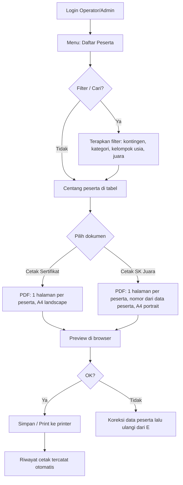
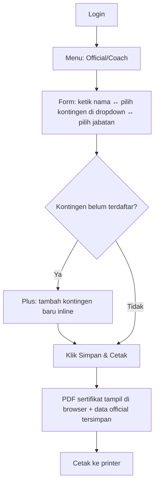
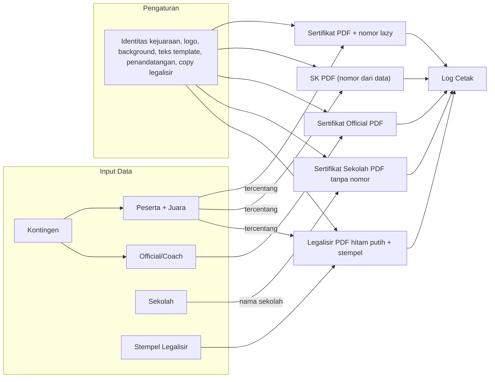
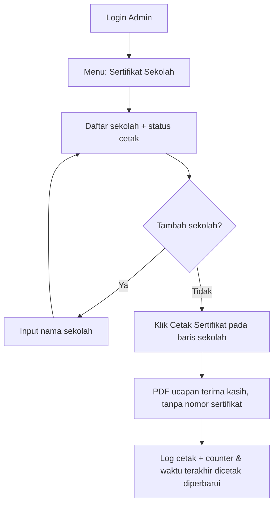

# PRD — Sistem Cetak Sertifikat Kejuaraan (SCS)

| Field | Nilai |
|---|---|
| Nama Produk | Sistem Cetak Sertifikat (SCS) |
| Versi Dokumen | 1.6 |
| Tanggal | 28 Oktober 2026 |
| Status | Draft untuk review |
| Dokumen Terkait | `INDEX.md`, `TRD.md`, `DB_SCHEMA.md`, `LEGALISIR_PLAN.md` |

---

## 1. Ringkasan Produk

Sistem web **monolitik** (Laravel + Blade + MySQL) untuk membantu panitia kejuaraan mengelola daftar peserta beserta peringkat juaranya, kemudian **mencetak dokumen resmi langsung dari browser dalam bentuk PDF**, tanpa generate API terpisah.

Dokumen yang dapat dicetak:

1. **Sertifikat Juara Peserta** — dipilih dari daftar peserta (bisa satu atau beberapa sekaligus/batch, satu halaman per peserta).
2. **SK Juara (Surat Keputusan)** — surat resmi per peserta juara; satu peserta = satu halaman SK; nomor SK dibaca dari data peserta (input manual panitia, boleh kosong).
3. **Sertifikat Coach / Official** — cukup input nama + pilih kontingen dari dropdown (kontingen yang sudah terdaftar).
4. **Sertifikat Legalisir** — versi hitam putih sertifikat peserta dengan satu stempel legalisir berwarna, dapat dicetak beberapa copy.

Deployment: dijalankan **di komputer lokal (panitia)**, lalu dipublikasikan ke internet via **Cloudflare Tunnel**, sehingga panitia di lokasi lain bisa mengakses melalui HTTPS.

---

## 2. Latar Belakang & Masalah

Praktik umum panitia kejuaraan saat ini:

- Sertifikat dibuat manual di Word/PowerPoint **satu per satu** → lama, rawan typo nama.
- Urutan/nomor juara sering berubah mendadak (koreksi hasil pertandingan) → file harus dirombak ulang.
- SK juara dibuat manual per kategori → nomor surat sering bentrok/terlewat.
- Sertifikat coach/official sering lupa karena datanya tidak tercatat di satu tempat.

**Tujuannya:** satu sistem dengan data terpusat, urutan cetak hampir tanpa mengetik ulang (kebanyakan memilih/centang), dan hasil PDF siap cetak.

---

## 3. Tujuan (S.M.A.R.T) per Fase Implementasi

Metode **S.M.A.R.T** — *Specific* (spesifik apa yang harus dicapai), *Measurable* (angka yang bisa diukur), *Achievable* (mampu dicapai dengan desain yang ada), *Relevant* (bernilai bagi panitia), *Time-bound* (ada tenggat yang jelas).

**Tujuan dipecah per fase implementasi** (mengikuti Implementation Plan §11.2), sehingga validasi dilakukan **saat fase ditutup**, bukan hanya di akhir proyek. Setiap fase punya tabel SMART tersendiri; kode tujuannya (`G-P0` s/d `G-P8.1`) dirujuk balik di §11.2.

### 3.1 Fase P0 — Setup & Fondasi (Hari 1–2)

| ID | Specific (S) | Measurable (M) | Achievable (A) | Relevant (R) | Time-bound (T) |
|---|---|---|---|---|---|
| **G-P0** | Lingkungan dev, skema DB, dan kerangka UI siap untuk semua fase berikutnya | `migrate --seed` sukses; halaman login tampil & bisa login; 1 lembar PDF demo DOMPDF (A4 landscape) tampil; aset Tailwind terbuild via Vite | Stack sudah dipilih & teruji (TRD §2); tidak ada desain baru di fase ini | Risiko teknis dihabisi di fase paling awal, bukan di hari-H | Hari ke-2 (tenggat akhir P0) |

### 3.2 Fase P1 — Data Master & Auth (Hari 3–5)

| ID | Specific (S) | Measurable (M) | Achievable (A) | Relevant (R) | Time-bound (T) |
|---|---|---|---|---|---|
| **G-P1** | Akses wajib login; kontingen & peserta (termasuk juara + `no_sk`) bisa dikelola, dicari, dan difilter | UT-01, UT-02, UT-10 lulus; 0 akses berhasil tanpa login; filter tetap aktif antar halaman (`withQueryString`); semua form menampilkan pesan validasi yang jelas | Session auth + FormRequest bawaan Laravel; tanpa komponen eksternal | Ketelitian data pada input menentukan akurasi dokumen pada output | Hari ke-5 |

### 3.3 Fase P2 — Cetak Sertifikat (Hari 6–8)

| ID | Specific (S) | Measurable (M) | Achievable (A) | Relevant (R) | Time-bound (T) |
|---|---|---|---|---|---|
| **G-P2** | Cetak sertifikat juara satuan & bulk; nomor sertifikat lazy-assignment yang konsisten | 30 sertifikat ≤ 3 menit end-to-end; batch 50 halaman ≤ 30 detik; 0 nomor ganda pada 50 uji cetak paralel oleh 2 operator; cetak ulang 10× menghasilkan nomor sama | DOMPDF stream + service `NomorSertifikat` (MAX+1, `GET_LOCK`, UNIQUE) | Menghapus pekerjaan Word/PowerPoint satu-per-satu di hari pertandingan | Hari ke-8; lulus UT-03, UT-05b, UT-05c + 3 sampel cetak fisik disetujui panitia |

### 3.4 Fase P3 — SK Juara & Sertifikat Official (Hari 9–11)

| ID | Specific (S) | Measurable (M) | Achievable (A) | Relevant (R) | Time-bound (T) |
|---|---|---|---|---|---|
| **G-P3.1** | SK juara portrait tercetak dengan nomor panitia yang tepat | UT-04 & UT-05 lulus; SK **bulk admin** dengan `no_sk` campur/kosong tetap tercetak; **satu peserta = satu halaman**; nomor kosong ditampilkan kosong | `LayananCetak` merender satu halaman per peserta; `no_sk` hanya label, bukan pengelompokan | SK = dokumen arsip resmi panitia kejuaraan | Hari ke-11 |
| **G-P3.2** | Sertifikat coach/official dibuat cepat lewat form nama + dropdown | Buat + cetak 1 official ≤ 30 detik (diuji oleh 5 operator berbeda) | Form 3 field; endpoint PDF mengikuti pola sertifikat peserta yang sudah jadi di P2 | Data official sering terlewat karena tidak tercantum di satu tempat | Hari ke-11 |

### 3.5 Fase P4 — Pengaturan, Log, User, Dashboard (Hari 12–14)

| ID | Specific (S) | Measurable (M) | Achievable (A) | Relevant (R) | Time-bound (T) |
|---|---|---|---|---|---|
| **G-P4** | Identitas dokumen bisa diatur tanpa deploy; setiap aksi cetak tercatat (audit) | 100% aksi cetak meninggalkan baris `print_logs` (sampling harian); UT-08 lulus; perubahan logo/background langsung tampak pada PDF berikutnya tanpa deploy | Pengaturan key-value `settings` + pembuatan log di satu titik (controller cetak) | Akuntabilitas dokumen resmi + kebebasan panitia memperbarui identitas visual | Hari ke-14 |

### 3.6 Fase P5 — Deploy & UAT (Hari 15–16)

| ID | Specific (S) | Measurable (M) | Achievable (A) | Relevant (R) | Time-bound (T) |
|---|---|---|---|---|---|
| **G-P5.1** | Sistem hidup di HTTPS publik via Cloudflare Tunnel | Uptime ≥ 99% selama 3 hari event; 0 akses berhasil tanpa login dari perangkat luar (UT-09) | Named tunnel + `TRUSTED_PROXIES` + cookie secure | Panitia di dua lokasi bisa mengakses server data yang sama | Hari ke-16 (sebelum event) |
| **G-P5.2** | Kualitas dokumen final terverifikasi menyeluruh | 0 typo pada sampel 100 dokumen (dicek oleh 2 operator berbeda); rekap lulus/tidak untuk semua tujuan `G-P0` s/d `G-P4` | Seluruh uji manual & otomatis telah tersusun di fase-fase sebelumnya | Sertifikat dibawa pulang peserta = reputasi kejuaraan | Sebelum kejuaraan pertama digunakan |

**Hasil agregat** bila semua fase terkunci: cetak 30 sertifikat ≤ 3 menit, 0 typo, nomor konsisten & dipakai ulang, audit 100%, akses publik HTTPS — semuanya terukur dan teruji fase demi fase (daftar kasus uji: TRD §12).

### 3.7 Fase P6 — Cetak Guest & Blangko (22 Oktober 2026)

| ID | Specific (S) | Measurable (M) | Achievable (A) | Relevant (R) | Time-bound (T) |
|---|---|---|---|---|---|
| **G-P6.1** | Peserta & pelatih bisa mengunduh sertifikatnya sendiri **tanpa login** | 100% cetak tamu menghasilkan PDF valid; request ke-31 dalam 1 jam → 429; daftar menampilkan 15 peserta per halaman; pencarian nama bekerja | Route publik + RateLimiter `cetak-publik` (30/jam/IP) + `publik` (60/menit/IP); log cetak dengan `user_id` kosong | Peserta yang tidak punya akun tetap bisa membawa sertifikatnya pulang | Aktif sejak 22 Okt 2026; UAT saat P5 |
| **G-P6.2** | Admin bisa menempatkan teks di atas gambar blangko (sertifikat & SK) **tanpa menyentuh kode** | 100% elemen tersimpan pada koordinat yang dipilih (selisih ≤ 1 mm antara kanvas dan PDF); 2 jenis blangko (sertifikat, SK) berhasil dibuat & dipakai saat cetak | Desainer drag & drop (vanilla JS) + koordinat **milimeter** — satuan yang sama berlaku di browser (96 dpi) dan DOMPDF | Blangko committee sudah berupa gambar; menentukan posisi piksel manual sangat melelahkan | Aktif sejak 22 Okt 2026; penyempurnaan pada sesi UAT |
| **G-P6.3** | Satu blangko bisa dipakai untuk sertifikat **prestasi** dan **pemasalan** | Varian terpilih otomatis sesuai kelompok usia untuk 100% peserta uji (Usia Dini 1 → Pemasalan; Dewasa → Prestasi) | Tabel `teks_varians` + kolom `pesertas.kelompok_usia` + daftar kelompok usia yang dapat diubah di Pengaturan | Committee hanya punya satu format blangko untuk dua jenis sertifikat | Aktif sejak 22 Okt 2026 |
| **G-P6.4** | Admin bisa memilih **dua cara** membuat blangko: desainer kanvas **atau** file Blade dari `resources/views/blangko/` | 100% blangko mode Blade memakai file yang dipilih; template di luar folder ditolak; preview & PDF merender file yang sama; template contoh berhasil dicetak 1 halaman per peserta | Kolom `mode` + `view_blade`; pemindaian otomatis folder (kecuali halaman admin); `BlangkoRenderer::renderBlade()` dengan kontrak variabel yang didokumentasikan | Sebagian desain lebih cepat dibuat langsung dengan HTML/CSS, sebagian lagi berupa gambar scan | Aktif sejak 23 Okt 2026 |
| **G-P6.5** | Blangko mengikuti **ukuran kertas standar** (A4/F4/Letter) tanpa mengisi mm manual | 100% blangko preset menghasilkan PDF dengan ukuran halaman sesuai kertas (A4 210×297, F4 215×330, Letter 216×279 mm); orientasi landscape menukar lebar/tinggi; ukuran custom tetap tersedia | Kolom `ukuran_kertas` + `orientasi`; dimensi mm dihitung server-side; `@page` DOMPDF memakai `lebar_mm × tinggi_mm` aktual untuk mode kanvas maupun Blade | Panitia memakai kertas A4/F4 yang berbeda-beda, sehingga ukuran tidak boleh di-hardcode | Aktif sejak 23 Okt 2026 |

### 3.8 Fase P7 — Sertifikat Sekolah (27 Oktober 2026)

| ID | Specific (S) | Measurable (M) | Achievable (A) | Relevant (R) | Time-bound (T) |
|---|---|---|---|---|---|
| **G-P7.1** | Admin dapat mencetak **sertifikat ucapan terima kasih** untuk sekolah yang berpartisipasi | 100% sekolah yang ditambahkan muncul di daftar; setiap cetak menghasilkan PDF valid tanpa nomor sertifikat; jumlah cetak & waktu terakhir tercatat | Menu admin **Sertifikat Sekolah** + tabel `sekolahs`; blangko jenis **`sertifikat_sekolah`** terpisah dari blangko peserta; route cetak di grup `admin` | Sekolah mitra perlu bukti partisipasi; pencetakan tidak boleh tercampur dengan sertifikat peserta/juara | Aktif sejak 27 Oktober 2026 |

### 3.9 Fase P8 — Legalisir Sertifikat Peserta (28 Oktober 2026)

| ID | Specific (S) | Measurable (M) | Achievable (A) | Relevant (R) | Time-bound (T) |
|---|---|---|---|---|---|
| **G-P8.1** | Admin dapat mencetak sertifikat peserta versi **hitam putih + satu stempel legalisir**, dengan jumlah copy yang dapat diatur | 100% cetak legalisir menghasilkan PDF valid; jumlah halaman = peserta valid × copy; stempel berada pada posisi desain; copy default 2 dan bisa 3/4 dst.; 0 akses operator/tamu | Menu `/legalisir` + CRUD `/legalisir/stempel`; grayscale GD + CSS; overlay stempel absolut mm; setting `legalisir_jumlah_copy`; batas 50 peserta / 200 halaman | Panitia membutuhkan arsip legalisasi resmi tanpa mencetak ulang desain berwarna | Aktif sejak 28 Oktober 2026; 21 test legalisir hijau |

---

## 4. Ruang Lingkup

### 4.1 In-Scope (Rilis Pertama / MVP)

| Kode | Fitur |
|---|---|
| F-01 | Autentikasi (login/logout), 2 peran: **Admin**, **Operator** |
| F-02 | Dashboard ringkas (jumlah kontingen, peserta, juara, jumlah cetak hari ini) |
| F-03 | Manajemen Kontingen (CRUD) |
| F-04 | Manajemen Peserta (CRUD) + pengisian **kategori, kelas, juara/keterangan (teks bebas: Peserta, Pesilat Terbaik, Juara 1, … atau kosong)** + **no_sk (input manual)** |
| F-05 | Daftar peserta + juara: tabel, pencarian, filter (kontingen/kategori/kelompok usia/juara), **checkbox multi-select** |
| F-06 | Cetak **Sertifikat Juara** peserta (tunggal & batch, 1 halaman per peserta, A4 landscape) |
| F-07 | Cetak **SK Juara** (tunggal & batch, A4 portrait, 1 peserta = 1 halaman, nomor SK dari data peserta) |
| F-08 | Cetak **Sertifikat Coach/Official** (form input nama → pilih kontingen dari dropdown → pilih jabatan → cetak) |
| F-09 | Riwayat cetak (audit log: siapa, kapan, dokumen apa) |
| F-10 | Pengaturan dokumen: nama kejuaraan, penyelenggara, logo, background sertifikat, template teks, penandatangan |
| F-11 | **Cetak tanpa login (tamu)**: daftar peserta publik (15 per halaman) + pencarian nama, cetak sertifikat & SK; sertifikat coach/official cukup nama + kontingen |
| F-12 | **Blangko & Desainer**: dua mode — unggah gambar blangko + tempatkan elemen teks dengan drag & drop (posisi & ukuran mm), **atau** pakai file `.blade.php` dari `resources/views/blangko/` |
| F-13 | **Varian teks otomatis**: satu blangko untuk sertifikat prestasi & pemasalan; versi dipilih otomatis dari kelompok usia peserta |
| F-14 | **Blangko mode Blade**: template HTML/CSS sendiri, memakai variabel `$data`, `$kop`, `$varianTeks`, `$baris`, `$blangko`; sertifikat & SK dirender **satu halaman per peserta**; template SK contoh memakai `$data`, `$baris` tersedia untuk template tabel |
| F-18 | **Sertifikat Sekolah** (khusus admin): daftar sekolah, tambah nama sekolah, status & jumlah cetak, serta cetak sertifikat ucapan terima kasih **tanpa nomor sertifikat** memakai blangko jenis `sertifikat_sekolah` yang terpisah dari blangko peserta |
| F-19 | **Legalisir Sertifikat Peserta** (khusus admin): cetak sertifikat peserta hitam putih dengan satu stempel legalisir berwarna; desain stempel dapat dibuat banyak dengan satu posisi tetap per desain; jumlah copy dapat diatur (default 2); bulk maks 50 peserta / 200 halaman |

### 4.2 Out-of-Scope (Tidak dibuat di versi ini)

- Registrasi/pendaftaran peserta oleh publik (self-registration).
- Pembayaran, bracket/match management, live scoring.
- Multi-event / multi-tenant (satu instalan = satu kejuaraan; identitas kejuaraan diatur di Pengaturan).
- Tanda tangan digital (e-signature) — tanda tangan hanya nama/jabatan terang di dokumen.
- Mobile app native (cukup web responsif).
- REST API publik (sistem sengaja monolitik, bukan API-based).

---

## 5. Persona Pengguna

| Persona | Deskripsi | Kebutuhan Utama | Akses |
|---|---|---|---|
| **Admin** | Ketua panitia / IT kejuaraan | Setup awal: user, pengaturan dokumen, verifikasi data akhir | Semua fitur |
| **Operator (Panitia Data)** | Petugas meja data saat event | Input/correct data cepat, langsung cetak dokumen | Semua kecuali pengaturan sistem & manajemen user |

> Peserta dan coach **tidak punya akun**. Dokumen hanya dicetak oleh panitia.

---

## 6. Kebutuhan Fungsional & User Stories

Prioritas: **M** = Must (MVP), **S** = Should, **C** = Could.

| ID | Fitur | User Story | Kriteria Penerimaan | Prioritas |
|---|---|---|---|---|
| FR-01 | Login/Logout | Sebagai operator, saya ingin login agar data kejuaraan tidak bisa diakses orang luar | Login pakai email+password; sesi habis saat logout; percobaan login dibatasi (rate limit); role menentukan menu | M |
| FR-02 | Dashboard | Sebagai panitia, saya ingin lihat ringkasan data | Kartu: total kontingen, total peserta, juara 1/2/3, jumlah label Peserta/Pesilat Terbaik, total halaman tercetak hari ini | M |
| FR-03 | Kontingen CRUD | Sebagai operator, saya ingin mendaftarkan kontingen | Nama kontingen unik; opsional kota/daerah; tidak boleh dihapus bila masih dipakai (atau hapus berantai diperingatkan) | M |
| FR-04 | Peserta CRUD | Sebagai operator, saya ingin input peserta + keterangan juaranya | Field: nama, kontingen (dropdown), jenis kelamin, kategori, kelas (opsional), **juara/keterangan (input teks + saran: Peserta, Pesilat Terbaik, Juara 1/2/3; opsional)**, **no_sk (input manual, opsional)**. Validasi wajib | M |
| FR-05 | Daftar & Pemilihan | Sebagai operator, saya ingin lihat daftar peserta+juara lalu centang yang akan dicetak | Kolom: No, Nama, Kontingen, Kategori, Kelas, Badge Juara; filter kontingen/kategori/kelompok usia/juara + pencarian nama; **select all**; urut default: kategori → juara → nama; hover baris menampilkan aksi edit/hapus | M |
| FR-06 | Cetak Sertifikat Peserta | Sebagai operator, saya ingin cetak sertifikat untuk peserta tercentang | Tombol "Cetak Sertifikat" di atas tabel **+ tombol cetak per-baris** (via checkbox: centang 1 = satuan, centang banyak = bulk); **PDF dibuka di tab baru**; PDF dimuat langsung di browser (stream); **1 peserta = 1 halaman**; urut sesuai urutan pilihan; nama, juara, kontingen & **nomor sertifikat** diambil dari DB; **semua peserta yang punya keterangan juara (termasuk label Peserta) dapat dicetak**; hanya Juara 1/2/3 dan Pesilat Terbaik yang memperoleh nomor (**nomor baru = nomor terakhir + 1**); label Peserta tetap `NULL`; minimal 1 peserta harus tercentang; maksimal 50; cetak ulang menghasilkan nomor yang sama | M |
| FR-07 | Cetak SK Juara | Sebagai operator, saya ingin cetak SK untuk juara terpilih | **PDF dibuka di tab baru**; PDF A4 portrait: kop identitas kejuaraan, **nomor SK dibaca dari kolom `no_sk`** (input manual panitia; boleh kosong; bukan digenerate saat cetak; template contoh saat ini tidak menampilkan baris nomor), **satu peserta = satu halaman**, tabel berisi peserta halaman tersebut, blok penandatangan; nomor SK tercatat di riwayat | M |
| FR-08 | Sertifikat Official | Sebagai operator, saya ingin buat sertifikat coach/official dengan cepat | Form: **input nama** + **dropdown kontingen** (dari data terdaftar) + dropdown jabatan (Coach/Official/Manager/Lainnya) + tombol simpan & cetak; PDF tampil langsung | M |
| FR-09 | Riwayat Cetak | Sebagai admin, saya ingin audit siapa mencetak apa | Tabel log: waktu, user, jenis dokumen, subjek (nama peserta/official), jumlah halaman, nomor SK (jika ada); filter tanggal & jenis | S |
| FR-10 | Pengaturan Dokumen | Sebagai admin, saya ingin isi identitas kejuaraan sekali untuk semua dokumen | Form pengaturan: nama kejuaraan, penyelenggara, tempat & tanggal, logo kiri/kanan (upload), background sertifikat (upload), template teks sertifikat (placeholder `{NAMA}`, `{NOMOR_SERTIFIKAT}`, `{JUARA_ANGKA}`, `{KATEGORI}`, `{KELAS}`, `{KONTINGEN}`), nama & jabatan penandatangan | S |
| FR-11 | Manajemen User | Sebagai admin, saya bisa tambah/matikan akun operator | Hanya role admin; bisa reset password operator | S |
| FR-12 | Ekspor Excel daftar | Sebagai operator, saya ingin ekspor daftar peserta untuk gratis rekap | Ekspor CSV dari hasil filter | C |
| FR-13 | Cetak tanpa login (tamu) | Sebagai peserta, saya ingin mengunduh sertifikat saya sendiri tanpa punya akun | Halaman publik menampilkan seluruh nama peserta (15/halaman) + pencarian nama; tombol **Sertifikat** muncul untuk semua peserta yang punya keterangan juara (termasuk `Peserta`), tombol **SK** per peserta; PDF valid; cetak tamu juara 1/2/3 & Pesilat Terbaik mengalokasikan nomor `MAX+1`, sedangkan label `Peserta` tetap `NULL`; batas 30 PDF/jam per IP; semua cetak tamu tercatat di riwayat (user_id kosong) | M |
| FR-14 | Sertifikat coach untuk tamu | Sebagai pelatih, saya ingin cetak sertifikat cukup dengan nama + kontingen | Form publik: nama + dropdown kontingen + jabatan → langsung PDF; tidak perlu membuat akun atau input ke admin | M |
| FR-15 | Blangko & desainer | Sebagai admin, saya ingin menempatkan teks di atas gambar blangko tanpa harus paham HTML/CSS | **Mode kanvas:** upload gambar blangko; pilih ukuran kertas **A4/F4/Letter/Custom** + orientasi (mm dihitung otomatis); kotak teks bisa digeser & diubah ukuran (mm); isi elemen bisa **dari data DB** (nama, jenis kelamin, kontingen, kategori, kelas, kelompok usia, juara, nomor) atau **teks bebas** atau **varian teks**; preview di browser identik dengan hasil PDF | M |
| FR-16 | Varian sertifikat otomatis | Sebagai admin, saya ingin satu blangko untuk sertifikat prestasi dan pemasalan | Kelompok usia "Pra Usia Dini" & "Usia Dini 1" → varian **Pemasalan**; "Usia Dini 2", "Pra Remaja", "Remaja", "Dewasa" → varian **Prestasi**; daftar kelompok usia dapat diubah di Pengaturan | M |
| FR-17 | Blangko mode Blade | Sebagai admin yang nyaman dengan HTML/CSS, saya ingin memakai file template sendiri | Saat membuat blangko, pilih **Mode Blade** lalu pilih file `.blade.php` dari `resources/views/blangko/` (halaman admin tidak muncul); template menerima `$data`, `$kop`, `$varianTeks`, `$baris` (SK), `$blangko`; yang ditulis hanya isi halaman (satu `<div>` berukuran mm) — sistem menambahkan `@page` sesuai ukuran blangko; **sertifikat: satu render = satu peserta, bulk di-loop sistem**; **SK: satu render = satu halaman/peserta; template contoh memakai `$data`, `$baris` tersedia untuk template tabel**; file di luar folder ditolak | M |
| FR-18 | Sertifikat Sekolah | Sebagai admin, saya ingin mencetak sertifikat ucapan terima kasih untuk sekolah yang berpartisipasi | Menu **Sertifikat Sekolah** hanya untuk admin; admin menambah sekolah cukup dengan **nama**; daftar menampilkan semua sekolah + status pernah dicetak, waktu terakhir, dan jumlah cetak; tombol **Cetak Sertifikat** membuka PDF di tab baru; sertifikat **tidak memakai nomor sertifikat**; memakai blangko jenis **`sertifikat_sekolah`** yang terpisah dari blangko peserta; bila belum ada blangko khusus, sistem memakai template bawaan berbasis `public/blangko-assets/sert-sekolah.jpg`; setiap cetak tercatat di riwayat dan menambah counter sekolah | M |
| FR-19 | Legalisir Sertifikat Peserta | Sebagai admin, saya ingin mencetak sertifikat peserta versi hitam putih dengan stempel legalisir untuk arsip resmi | Menu **Legalisir** hanya untuk admin; peserta dipilih dari `/peserta` (bulk atau per baris); halaman `/legalisir` menampilkan peserta terpilih, pilihan **satu stempel aktif**, jumlah copy, dan total halaman; PDF **hitam putih** dengan **tepat satu stempel** pada posisi desain; **copy default 2** (1–20) diatur di Pengaturan; **maks 50 peserta** dan **200 halaman** per PDF; hanya sertifikat peserta (memakai blangko peserta aktif); nomor sertifikat mengikuti aturan lazy lama; log `legalisir` + `jumlah_copy`; operator/tamu ditolak | M |

---

## 7. Alur Pengguna (User Flow)

### 7.1 Flow 1 — Cetak Sertifikat & SK Juara Peserta



### 7.2 Flow 2 — Sertifikat Coach / Official



### 7.3 Alur Data (Data Flow)



### 7.4 Flow 4 — Sertifikat Sekolah (Admin)



### 7.5 Flow 5 — Legalisir Sertifikat Peserta (Admin)

```mermaid
flowchart TD
    A[Login Admin] --> B[Peserta & Juara]
    B --> C[Centang peserta]
    C --> D[Klik Legalisir]
    D --> E[/legalisir?ids[]=...]
    E --> F[Pilih 1 stempel aktif]
    F --> G[Lihat copy & total halaman]
    G --> H{Peserta valid & batas aman?}
    H -->|Tidak| I[Pesan: tanpa juara / stempel kosong / melebihi batas]
    H -->|Ya| J[Cetak Legalisir]
    J --> K[PDF hitam putih + stempel, tab baru]
    K --> L[Log legalisir + jumlah_copy]
```

---

## 8. Kebutuhan Non-Fungsional

| Kategori | Kebutuhan |
|---|---|
| Performa | Render PDF 1 halaman ≤ 5 detik; batch 50 halaman ≤ 30 detik; daftar peserta 1.000 baris tetap nyaman dibaca (paginasi 25–50 baris per halaman) |
| Keamanan | Semua route di belakang login; rate-limit login (5x/menit); CSRF token di semua form; validasi semua input; upload gambar dibatasi (jpg/png/webp, maks 2 MB) |
| Ketersediaan | Berjalan di PC lokal (Windows); tetap berfungsi offline penuh — Cloudflare Tunnel hanya jembatan akses publik |
| Aksesibilitas Publik | HTTPS otomatis via Cloudflare Tunnel; URL dapat dipasang domain panitia |
| Kompatibilitas | Chrome/Edge/Firefox versi modern; desktop-first (utama di PC panitia), tetap terbaca di tablet |
| Keandalan Dokumen | Font PDF bundel DOMPDF (`DejaVu Sans`) agar nama tetap benar; hasil PDF identik antar-browser |
| Audit | Setiap cetak menghasilkan baris log yang tidak bisa dihapus dari UI |
| Bahasa | UI dan dokumen berbahasa Indonesia |

---

## 9. Aturan Bisnis

1. **Juara/keterangan** berupa teks bebas — mis. `Peserta`, `Pesilat Terbaik`, atau `Juara 1` — atau **kosong** (belum ada keterangan). Nilai lama `1`/`2`/`3` tetap didukung dan dipetakan ke Emas/Perak/Perunggu. Hanya **Juara 1, Juara 2, Juara 3, dan Pesilat Terbaik** yang berhak mendapat nomor sertifikat; peserta berlabel **Peserta** tidak mendapat nomor. Di halaman tamu `/cetak` dan cetak admin `/peserta`, sertifikat dapat dicetak untuk semua peserta yang punya keterangan juara (termasuk `Peserta`); juara 1/2/3 dan Pesilat Terbaik mendapat nomor `MAX+1`, sedangkan `Peserta` tetap tanpa nomor. Peserta tanpa keterangan juara tidak bisa mencetak.
2. **Satu baris peserta = satu kepesertaan dalam satu kategori.** Jika orang yang sama ikut 2 kategori, masukkan 2 baris (nama boleh sama).
3. **Batch cetak** maksimal **50 peserta** per unduhan PDF agar server lokal stabil. Karena nomor sudah berbasis data (bukan berbasis aksi cetak), bulk dan satuan memiliki tingkat risiko yang sama — mode dipilih sesuai ergonomi printer.
4. **Nomor sertifikat** di-generate **saat cetak pertama** (admin atau tamu `/cetak`): sistem mengambil `MAX(no_sertifikat)` di tabel pesertas lalu menambah 1 (batch admin = diberi berurutan 1..n sesuai urutan pilihan). Baris yang **sudah punya nomor dipakai ulang tanpa perubahan** — cetak ulang 10× nomornya tetap. Hanya **Juara 1/2/3 dan Pesilat Terbaik** yang memperoleh nomor; label **Peserta** tidak. Label **Peserta** tetap bisa dicetak dari `/cetak`, tetapi `no_sertifikat` dibiarkan `NULL`. **Nomor SK** diinput manual oleh panitia di data peserta; SK hanya membacanya. Nomor SK boleh kosong; SK tetap tercetak tanpa nomor.
5. **Menghapus kontingen** akan ikut menghapus peserta & official di dalamnya (dengan konfirmasi bertingkat di UI).
6. Peran **Operator tidak boleh** mengubah Pengaturan Dokumen dan akun user.
7. Semua dokumen dicetak via browser (PDF stream), bukan file yang disimpan di server.
8. **Cetak tamu terbuka tanpa login** — seluruh nama peserta dapat dilihat (15 per halaman) dan dicari; jumlah unduhan dibatasi **30 PDF/jam per IP**; setiap cetak tamu tetap tercatat di riwayat (user_id kosong).
9. **Varian sertifikat ditentukan otomatis** dari kelompok usia peserta: "Pra Usia Dini" & "Usia Dini 1" memakai varian **Pemasalan**; "Usia Dini 2", "Pra Remaja", "Remaja", "Dewasa" memakai varian **Prestasi**. Daftar kelompok usia dapat diubah di Pengaturan.
10. **Tata letak blangko disimpan dalam milimeter** — koordinat yang sama dipakai untuk preview di browser dan untuk PDF, sehingga yang terlihat di desainer = yang tercetak.
11. **Blangko punya dua mode** — `canvas` (gambar + elemen teks lewat desainer) atau `blade` (file `.blade.php` di `resources/views/blangko/`). Mode dipilih saat membuat blangko dan bisa diubah lewat halaman Pengaturan. Template Blade **hanya menulis isi halaman**. **Ukuran kertas** dipilih dari preset **A4 / F4 / Letter / Custom** + orientasi; `lebar_mm`/`tinggi_mm` dihitung otomatis (landscape menukar) dan menjadi ukuran `@page` DOMPDF di kedua mode. File di luar folder `resources/views/blangko/` dan halaman admin (`index`, `form`, `desainer`, `preview`, `blade`) tidak boleh dipilih.
12. **Sertifikat sekolah adalah dokumen terpisah** — hanya **Admin** yang dapat membuka daftar sekolah dan mencetaknya; sekolah cukup diinput dengan **nama** (unik); sertifikat **tidak memiliki nomor sertifikat**; blangko yang dipakai adalah jenis **`sertifikat_sekolah`**, bukan blangko sertifikat peserta/SK; daftar menampilkan semua sekolah beserta status pernah dicetak, waktu terakhir, dan jumlah cetak; setiap cetak menambah counter dan tercatat di riwayat cetak. Bila belum ada blangko `sertifikat_sekolah` yang aktif, sistem memakai template bawaan `pdf/sertifikat-sekolah` berbasis `public/blangko-assets/sert-sekolah.jpg`.
13. **Legalisir adalah dokumen khusus admin** — hanya **sertifikat peserta** yang dapat dilegalisir, memakai **blangko peserta aktif** (fallback layout bawaan). Setiap sertifikat memakai **tepat satu stempel** dari desain yang dipilih; **satu desain stempel = satu posisi tetap** dalam milimeter dari sudut kiri atas. Jumlah copy per sertifikat diatur di Pengaturan (`legalisir_jumlah_copy`, default **2**, rentang **1–20**); total halaman = jumlah peserta valid × copy, dengan batas **50 peserta** dan **200 halaman** per PDF. Sertifikat dicetak **hitam putih**, sedangkan **stempel tetap berwarna**. Peserta tanpa keterangan juara dilewati (semua tanpa juara → ditolak); nomor sertifikat tetap mengikuti aturan lazy assignment. Setiap cetak mencatat `jenis_dokumen = 'legalisir'` dan `jumlah_copy`.

---

## 10. Asumsi

- Jenis lomba bersifat bebas olahraga (mis. karate: Kata/Kumite) — sistem menyimpan teks **kategori** dan **kelas** generik, tidak memvalidasi regulasi cabang olahraga.
- Hanya **satu kejuaraan aktif** per instalan; jika tahunan diganti, cukup update Pengaturan + bersihkan data (fitur reset data = Could, FR-C).
- Printer-nya di sisi pengguna yang membuka PDF (browser print dialog) — sistem tidak berintegrasi langsung ke mesin printer.
- Jumlah data realistis: ≤ 5.000 baris peserta per kejuaraan.
- **Nomor SK** merupakan nomor dokumen resmi yang ditentukan panitia (input manual di data peserta); sistem hanya membacanya, tidak men-generate. Jika kosong, SK tetap tercetak tanpa nomor.

---

## 11. Implementation Plan

Rencana eksekusi pengembangan dari nol hingga siap dipakai di event. Asumsi 1 developer, total ≈ **3 minggu kerja (16 hari)**. Fase P0–P5 memenuhi milestone M1–M2; milestone M3 berjalan pasca-rilis.

### 11.1 Ringkasan Milestone

| Milestone | Isi | Target | Fase |
|---|---|---|---|
| **M1 — MVP** | F-01 s/d F-08 (login, kontingen, peserta, daftar+filter, cetak sertifikat, cetak SK, sertifikat official) | Hari 1–11 | P0–P3 |
| **M2 — Lengkap** | F-09 s/d F-11 (riwayat cetak, pengaturan dokumen, manajemen user), tuning template, polish UI, deploy tunnel | Hari 12–16 | P4–P5 |
| **M3 — Ekstra** | FR-12 ekspor, template multi-desain, reset data musiman | Menyusul | — |
| **P6 — Cetak Guest & Blangko** (tambahan) | FR-13 s/d FR-17: cetak tanpa login, desainer blangko, blangko mode Blade, varian otomatis | 22–23 Okt 2026 | Selesai |
| **P7 — Sertifikat Sekolah** (tambahan) | FR-18: daftar sekolah + sertifikat ucapan terima kasih tanpa nomor | 27 Okt 2026 | Selesai |
| **P8 — Legalisir** (tambahan) | FR-19: legalisir hitam putih + stempel, copy, batas cetak | 28 Okt 2026 | Selesai |

### 11.2 Rencana Detail per Fase

> Fase di tabel ini **satu-satu memvalidasi tujuan SMART** yang dijabarkan di **§3** (kode `G-P0` s/d `G-P8.1`); kolom *Definition of Done* = prasyarat teknis berikut rujukan kode goal & kasus uji (TRD §12).

| Fase | Durasi | Aktivitas Utama | Deliverable | Definition of Done (Acceptance & Goal) |
|---|---|---|---|---|
| **P0 — Setup & Fondasi** ✅ | Hari 1–2 | Scaffold Laravel 12 (`composer create-project`), install `barryvdh/laravel-dompdf`, setup Tailwind (Vite), install Laragon/MySQL; buat migrasi 6 tabel + seed; buat model & `$fillable`; scaffolding layout app (sidebar + Tailwind) | Repo berjalan, DB migrasi sukses, halaman login tampil | `php artisan migrate --seed` sukses; `php artisan serve` bisa dibuka; `npm run dev` OK; login default masuk ke dashboard kosong; 1 lembar PDF demo tampil → **G-P0** |
| **P1 — Data Master & Auth** ✅ | Hari 3–5 | Login/logout + rate limit (FR-01); CRUD kontingen (FR-03); CRUD peserta (FR-04, termasuk `no_sk`); daftar peserta + filter + badge juara + checkbox select-all (FR-05) | Modul data master lengkap | UT-01, UT-02, UT-10 lulus; validasi error muncul; filter tidak hilang saat pindah halaman (`withQueryString`) → **G-P1** |
| **P2 — Cetak Sertifikat (inti)** ✅ | Hari 6–8 | Layout PDF base + template sertifikat landscape; service `NomorSertifikat` (lazy MAX+1, GET_LOCK); endpoint `/cetak/sertifikat/peserta` (batch + per-baris); tulis `print_logs` dasar | Fitur cetak sertifikat tunggal & bulk jalan | UT-03, UT-05b, UT-05c lulus; **3 sampel cetak fisik disetujui panitia** (ukuran, posisi nama, nomor): 30 sertifikat ≤ 3 menit; batch 50 ≤ 30 detik; 0 nomor ganda → **G-P2** |
| **P3 — SK Juara & Sertifikat Official** ✅ | Hari 9–11 | PDF SK portrait + satu peserta per halaman, `no_sk` opsional (FR-07); form official + cetak sertifikat official (FR-08); tombol per-baris di daftar official | Fitur cetak SK & official jalan | UT-04, UT-05, UT-07 lulus; SK fisik 2 sampel disetujui; official ≤ 30 detik/orang (5 operator) → **G-P3.1 & G-P3.2** |
| **P4 — Pengaturan, Log, User, Dashboard** ✅ | Hari 12–14 | Pengaturan dokumen (FR-10, upload logo/background); riwayat cetak + filter (FR-09); manajemen user (FR-11); dashboard ringkas (FR-02); semua placeholder (`{NOMOR_SERTIFIKAT}` dsb.) dibaca dari pengaturan; polish UI | Fitur pendukung lengkap | UT-08 lulus; 100% cetak meninggalkan baris log; perubahan logo/background langsung terlihat tanpa deploy → **G-P4** |
| **P5 — Deploy, Hardening, UAT** ⏳ | Hari 15–16 | Laragon/Apache sebagai service; named tunnel `cloudflared` + `TRUSTED_PROXIES`; `.env` produksi + cookie secure; checklist keamanan TRD §9; backup `mysqldump`; UAT terhadap tujuan SMART per fase (§3) | Sistem live di URL Cloudflare (HTTPS) | UT-09 lulus dari perangkat luar; uptime ≥ 99% & 0 akses tanpa login; 0 typo pada sampel 100 dokumen; rekap semua goal G-P0 s/d G-P4 tertandai lulus; backup restore diuji 1× → **G-P5.1 & G-P5.2** |
| **P6 — Cetak Guest & Blangko** ✅ | 1 sesi | Cetak tanpa login (tamu): daftar peserta 15/halaman + pencarian + PDF sertifikat/SK/official + rate limit; blangko **dua mode**: desainer kanvas drag & drop (sertifikat & SK) **atau** file Blade dari `resources/views/blangko/`; varian teks otomatis berdasarkan kelompok usia | Halaman `/cetak` untuk tamu, menu **Blangko & Teks** untuk admin | Cetak tamu menghasilkan PDF valid; request ke-31/jam → 429; elemen blangko tersimpan di koordinat mm yang sama dengan PDF; template Blade di luar folder ditolak & preview = PDF; varian Usia Dini 1 → Pemasalan, Dewasa → Prestasi → **G-P6.1, G-P6.2, G-P6.3, G-P6.4** |
| **P8 — Legalisir** ✅ | 1 sesi | Menu admin `/legalisir` + CRUD stempel; pilih peserta/stempel/copy; PDF hitam putih + overlay stempel; grayscale GD + CSS; setting copy; log copy | Halaman legalisir, editor stempel + preview, PDF legalisir | 21 test legalisir hijau; PDF 2 copy = 2 halaman; 2 peserta × 3 copy = 6 halaman; batas 50/200; stempel nonaktif/gambar hilang/di luar halaman ditolak; operator/tamu ditolak → **G-P8.1** |

### 11.3 Definition of Done Global (berlaku tiap fase)

1. Semua kasus uji (TRD §12) yang menyentuh fase tersebut **lulus**, termasuk uji cetak fisik minimal 2 sampel.
2. Tanpa bug blocker/critical; checklist keamanan TRD §9 dicentang untuk area yang tersentuh.
3. UI & dokumen berbahasa Indonesia; render PDF 1 halaman ≤ 5 detik.
4. Dokumen terkait (INDEX/TRD/DB) diperbarui bila ada keputusan yang berubah.

### 11.4 Risiko Jadwal & Mitigasi

| Risiko | Dampak | Mitigasi |
|---|---|---|
| Alignment template DOMPDF butuh beberapa kali uji cetak (±1–2 hari) | P2/P3 molor | Alokasikan 1 hari penyiapan template di P2 dan P3 masing-masing; siapkan 1 desain bawaan sederhana sejak P0 (pertanyaan desain PRD §12 wajib diputuskan saat P0) |
| Kertas blanko pre-printed ternyata ukurannya beda/uji nyata beda | Cetak ulang di hari-H | Uji cetak dengan kertas blanko asli di P3; sediakan varian margin via pengaturan |
| Integrasi Cloudflare Tunnel gagal (domain belum siap) | **G-P5.1** molor | P5 boleh mulai dengan Quick Tunnel (trycloudflare) sementara; named tunnel dipasang berurutan setelah domain aktif |
| Data peserta real masuk mendadak (malam sebelum event) | beban input | Siapkan input bulk sederhana (paste CSV manual di fase M3); sementara pakai entry form + copy-paste |

### 11.5 Status Implementasi & Bukti Validasi

Diperbarui: **28 Oktober 2026** — fase **P0, P1, P2, P3, P4, P6, P7, dan P8 selesai**; **P5 berjalan sebagian**: **Named Tunnel aktif di `https://sbcc.my.id`**, tinggal Cloudflare Access, uji dari perangkat luar, dan UAT cetak fisik. Checklist lengkap: [`UAT_P5.md`](UAT_P5.md).

| Fase | Status | Bukti Validasi | Catatan |
|---|---|---|---|
| **P0 - Setup & Fondasi** | ✅ **Selesai** | 9 migrasi + seed berjalan di MySQL 8.0.30; `GET /login` → HTTP 200; `GET /` tanpa login → 302 ke `/cetak` (perubahan 23 Okt 2026; sebelumnya `/login`); DomPDF render 1 halaman A4 landscape (878 KB, font DejaVu); `storage:link` aktif; `npm run build` menghasilkan manifest Vite | Stack aktual **Laravel 13.17** (bukan 12) — see TRD §2 |
| **P1 — Data Master & Auth** | ✅ **Selesai** | 24/24 test hijau (AuthTest, KontingenTest, PesertaTest, DashboardTest); UT-01 (lock login setelah 5× gagal) ✅; UT-02 (CRUD + validasi) ✅; UT-10 (hapus kontingen → cascade peserta) ✅; filter kontingen/kategori/kelompok usia/juara + pencarian nama ✅; `withQueryString` 유지kan filter antar halaman ✅ | Struktur data & UI sesuai DB_SCHEMA §2 |
| **P2 — Cetak Sertifikat** | ✅ **Selesai** | View `resources/views/pdf/**` (sertifikat A4 landscape: bingkai ganda, kop, logo, background, nomor, blok TTD); service `NomorSertifikat` (MAX+1 + `GET_LOCK`); tombol cetak satuan per baris & bulk via checkbox; **1 peserta = 1 halaman PDF** (terverifikasi: 2 peserta → 2 halaman, 3 peserta → 3 halaman); cetak ulang memakai nomor yang sama; di cetak admin, peserta tanpa juara dilewati + peringatan, sedangkan label **Peserta** tetap dicetak tanpa nomor; **admin dapat memilih cetak dengan/tanpa background, sedangkan tamu selalu dengan background** | Nomor sertifikat dialokasikan saat pertama dicetak (admin atau tamu `/cetak`) untuk Juara 1/2/3 dan Pesilat Terbaik, bukan saat peserta disimpan; label **Peserta** tidak dialokasikan |
| **P3 — SK Juara & Official** | ✅ **Selesai** | `pdf/sk-juara.blade.php` A4 portrait (kop, judul, nomor SK, Menimbang/Mengingat, tabel juara, blok TTD); **satu peserta = satu halaman SK** (2 peserta → 2 halaman PDF), nomor SK hanya label dan boleh kosong; di halaman tamu, SK perorangan juga satu halaman; modul Official: input nama + dropdown kontingen + jabatan → sertifikat PDF; admin juga dapat memilih Dengan/Tanpa background saat mencetak official | Penyimpangan dari rancangan awal: SK tidak lagi dikelompokkan per nomor, melainkan **satu peserta per halaman** — TRD §6.4 |
| **P4 — Pengaturan, Log, User** | ✅ **Selesai** | Halaman Pengaturan (identitas, penandatangan, upload logo kiri/kanan + background, template teks) — **khusus admin** (operator → 403); Riwayat Cetak dengan filter jenis/tanggal + total halaman tercetak; Manajemen User (buat/ubah/hapus, akun sendiri tidak bisa dihapus); dashboard menampilkan "halaman tercetak hari ini"; setiap aksi cetak tercatat di `print_logs` | Middleware `EnsureAdmin` (alias `admin`) |
| **P5 — Deploy & UAT** | 🟡 **Sebagian** | **Named Tunnel aktif di `https://sbcc.my.id`** (Cloudflare, domain `sbcc.my.id`, tunnel `sertifikat`, config `tools/cloudflared-named.yml`): `/up`, `/login`, `/cetak` → 200; request HTTP → **301 ke HTTPS** (middleware `ForceHttps`); login admin via HTTPS → `/dashboard` 200 dengan cookie `Secure` + `SameSite=Lax`; `/blangko` & `/blangko/5/preview` → 200; **PDF tamu** 508.228 byte `%PDF-`; **PDF bulk 3 peserta = 3 halaman** 509.207 byte; akses `/dashboard` tanpa login → 302; 4 koneksi tunnel terdaftar; sertifikat TLS `CN=sbcc.my.id` (Let's Encrypt via Cloudflare); script `tools/p5-start-named.ps1` + `tools/p5-stop.ps1` berfungsi; Quick Tunnel (`tools/p5-start.ps1`) tetap tersedia sebagai fallback | **Belum:** Cloudflare Access untuk area admin, uji UT-09 dari HP di luar jaringan, cetak fisik A4/F4, cek typo 100 dokumen, alignment TTD/stempel, backup/restore. Detail & sign-off: [`UAT_P5.md`](UAT_P5.md) |
| **P6 — Cetak Guest & Blangko** | ✅ **Selesai** | Halaman tamu `/cetak` (daftar 15/halaman + pencarian nama, tombol Sertifikat & SK per peserta) & `/cetak/official` (nama + dropdown kontingen + jabatan) tanpa login → PDF valid (488 KB); rate limit 30 PDF/jam/IP (request ke-31 → 429) teruji; blangko **dua mode**: (a) **kanvas** — upload gambar, drag & drop kotak teks, simpan posisi/ukuran mm, **edit & hapus elemen** lewat panel Daftar Elemen, preview, varian teks; (b) **Blade** — pilih file `.blade.php` dari `resources/views/blangko/`, editor menampilkan variabel + isi file, preview & PDF memakai template yang sama; template di luar folder ditolak (422); contoh `contoh-sertifikat` (landscape) & `contoh-sk` (portrait) berhasil dicetak; **ukuran kertas A4/F4/Letter/Custom** dengan dimensi mm otomatis & `@page` mengikuti ukuran (diuji lewat `MediaBox` PDF); varian otomatis: Usia Dini 1 → Pemasalan, Dewasa → Prestasi | 3 tabel baru (`blangkos`, `blangko_elemen`, `teks_varians`) + kolom `pesertas.kelompok_usia`, `blangkos.mode`, `blangkos.view_blade`, `blangkos.ukuran_kertas`; `print_logs.user_id` jadi nullable (tamu); route baru `blangko.form` (`/blangko/{id}/pengaturan`) |
| **P7 — Sertifikat Sekolah** | ✅ **Selesai** | Menu admin **Sertifikat Sekolah** (`/sekolah`); tambah sekolah cukup nama; daftar semua sekolah + status pernah dicetak, waktu terakhir, jumlah cetak; cetak PDF ucapan terima kasih **tanpa nomor** di tab baru; blangko jenis **`sertifikat_sekolah`** terpisah dari blangko peserta; fallback `pdf/sertifikat-sekolah` berbasis `public/blangko-assets/sert-sekolah.jpg`; log cetak `sertifikat_sekolah` + counter; `SekolahTest` **11 test / 42 assertion** | Tabel `sekolahs`; kolom `blangkos.jenis` & `print_logs.jenis_dokumen` diubah dari ENUM ke VARCHAR agar jenis dokumen baru tidak perlu migrasi enum; route `/sekolah`, `/sekolah` (POST), `/cetak/sertifikat/sekolah/{sekolah}`; menu sidebar **Sertifikat Sekolah** |
| **P8 — Legalisir** | ✅ **Selesai** | Menu admin **Legalisir** (`/legalisir`) + **Stempel Legalisir** (`/legalisir/stempel`); pilih peserta, satu stempel aktif, copy default 2; PDF hitam putih + stempel berwarna; grayscale GD + CSS; fallback layout peserta; log `legalisir` + `jumlah_copy`; batas 50 peserta / 200 halaman; `LegalisirTest` **21 test / 72 assertion** | Tabel `stempel_legalisirs`; kolom `print_logs.jumlah_copy`; setting `legalisir_jumlah_copy`; route `/legalisir`, `/legalisir/cetak`, `/legalisir/stempel*`; menu sidebar **Legalisir**; tombol bulk/per-baris di `/peserta` |

**Ringkasan validasi teknis (P0-P4, P6, P7, P8):** `144/144` test otomatis hijau (**533 assertion**), `Laravel Pint` style check lolos, `node --check public/js/blangko.js` lolos, dan **uji alur nyata via HTTP** (login → unduh PDF `application/pdf` 489 KB → halaman peserta; tamu → daftar → PDF sertifikat → PDF coach; admin → desainer → edit elemen (JSON `ok:true`) → preview → hapus elemen (JSON `ok:true`) → PDF dengan blangko; blangko Blade → preview → PDF; admin → daftar sekolah → tambah sekolah → PDF sertifikat sekolah) berhasil. **Legalisir** diverifikasi lewat `LegalisirTest` (PDF hitam putih + stempel, copy, grayscale); uji cetak fisik stempel masih menunggu. Daftar lengkap test: TRD §12.

**Validasi P5 (23 Oktober 2026):** **Named Tunnel** dijalankan dengan `tools/p5-start-named.ps1` untuk `https://sbcc.my.id`; `/up`, `/login`, `/cetak` 200; HTTP → 301 HTTPS; login admin via HTTPS berhasil (cookie `Secure`); `/dashboard`, `/blangko`, preview 200; PDF tamu & bulk 3 halaman valid; 4 koneksi tunnel terdaftar; `tools/p5-stop.ps1` menghentikan server + tunnel dengan bersih. Cloudflare Access dan UAT cetak fisik masih menunggu — lihat [`UAT_P5.md`](UAT_P5.md).

**Validasi P7 (27 Oktober 2026):** `SekolahTest` **11 test / 42 assertion** hijau; admin dapat melihat daftar, menambah sekolah (nama saja), menolak duplikat, mencetak PDF tanpa blangko khusus, memakai blangko `sertifikat_sekolah` yang terpisah, dan log `sertifikat_sekolah` tampil di Riwayat Cetak; operator & tamu ditolak (403/redirect). Saat penutupan P7, suite penuh **123/123** hijau (**461 assertion**), Pint lolos; setelah P8 menjadi **144/144** (**533 assertion**).

**Validasi P8 (28 Oktober 2026):** `LegalisirTest` **21 test / 72 assertion** hijau; admin dapat membuka halaman legalisir, memilih peserta & stempel, mencetak PDF hitam putih dengan stempel berwarna, mengatur copy (default 2, uji 3 → 6 halaman untuk 2 peserta), serta CRUD stempel termasuk validasi posisi. Operator & tamu ditolak; peserta tanpa juara dilewati/ditolak; batas 50 peserta & 200 halaman diuji; grayscale GD diverifikasi R=G=B dan tag stempel tidak diubah. Suite penuh **144/144** hijau (**533 assertion**), Pint lolos.

**Bug yang ditemukan & diperbaiki saat validasi P0–P8** (semua sudah tertutup dan ada test-nya):

1. **Route model binding gagal diam-diam** — `Str::singular('peserta')` di Laravel menghasilkan **`pesertum`** (aturan inflector Latin `-a` → `-um`, seperti `data` → `datum`), sehingga `Route::resource('peserta')` membuat parameter `{pesertum}` yang tidak cocok dengan variabel `$peserta` → controller menerima model **kosong** tanpa error. Perbaikan: `->parameters(['peserta' => 'peserta'])`. *Lesson: selalu cek `php artisan route:list` setelah menambah resource route.*
2. **Filter juara salah** — `when()` menerima **boolean** sehingga callback menerima `true`, bukan nilai filter → `where('juara', true)` ter-eksekusi sebagai `juara = 1`. Perbaikan: `when($filters['juara'] ?? null, ...)` menerima nilai filter langsung.
3. **Test gagal karena aset frontend belum di-build** — layout memakai `@vite`; tanpa `npm run build` manifest tidak ada dan seluruh test view gagal. Perbaikan: jalankan `npm run build` (atau `npm run dev`) sebelum `php artisan test`.
4. **Tidak ada ekstensi `pdo_sqlite`** di PHP mesin ini → test diarahkan ke database MySQL khusus `sistem_cetak_sertifikat_test` (setting di `phpunit.xml`).
5. **Ekstensi `zip` PHP tidak ada** → Composer memakai `unzip.exe` milik Laragon (fallback otomatis, tidak masalah).
6. **Typo key pada view PDF** — view memakai `$kop['kota_tdd']` (kurang satu huruf) sedangkan key-nya `kota_ttd` → seluruh render sertifikat gagal dengan "Undefined array key". Perbaikan: samakan penulisan key. *Lesson: gunakan konstanta/array key bersama bila field dipakai di banyak view.*
7. **Validasi endpoint cetak mengarahkan (302), bukan menolak** — `$request->validate()` pada request GET me-redirect ke halaman sebelumnya sehingga pesan error tidak terlihat saat menekan tombol cetak. Perbaikan: validasi manual via `Validator` + `abort(422, pesan)` di `CetakController::validasiIds()`.
8. **`Setting::urlGambar` dipanggil sebagai callable tanpa tanda kurung** → PHP_constant `Undefined constant`. Perbaikan: kirim **closure** ke view (`fn ($v) => Setting::urlGambar($v)`).
9. **`getCanvas()->get_page_count()` DomPDF tidak akurat** — selalu mengembalikan 1 halaman meski PDF berisi 3 halaman. Perbaikan: jumlah halaman dihitung dari isi file (`/Type /Page`) dan itu yang dipakai di test.
10. **Data seed kategori & kelas tumpang tindih** — kategori "Kumite -50 kg Putri" + kelas "-50 kg" menghasilkan teks dobel ("Kumite -50 kg Putri - -50 kg"). Perbaikan: kategori dipisah dari kelas ("Kumite Putri" + "-50 kg").
11. **Nama tabel `blangko_elemen` jadi `blangko_elemens`** — pluralisasi otomatis Laravel mengubah kata Indonesia "elemen" menjadi "elemens". Perbaikan: `protected $table = 'blangko_elemen';` pada model.
12. **Placeholder `{NAMA}` tidak ter-substitusi di teks varian** — `strtr($isi, $data)` memakai kunci polos ("nama"), sedangkan placeholder memakai kurung. Perbaikan: helper `pengganti()` memetakan data → `{NAMA}`, `{KONTINGEN}`, dst.
13. **FK `print_logs_user_foreign` tidak ada** — Laravel memberi nama FK standar `print_logs_user_id_foreign`, sehingga `DROP FOREIGN KEY` manual gagal. Perbaikan: memakai `dropForeign(['user_id'])` dari Schema Builder.
14. **Metode `sertifikatOfficial` hilang saat refactor ke service** — route masih menunjuk controller lama → error 500. Perbaikan: method delegasi ditambahkan kembali di `CetakController` (test regresi sekarang menutupnya).
15. **Edit & hapus elemen desainer tidak bisa dipakai** — setiap klik pada kotak langsung dianggap selesai menggeser, sehingga memicu simpan + reload; elemen tak pernah benar-benar terpilih dan tombol Hapus tak pernah muncul. Perbaikan: ambang gerak 2 px (klik = pilih, bukan simpan), simpan via AJAX tanpa reload + pembaruan kotak/daftar di tempat, panel **Daftar Elemen** dengan tombol Edit/Hapus per elemen, dan endpoint simpan/hapus mengembalikan JSON untuk AJAX.
16. **Halaman editor Blade gagal dikompilasi (`Malformed @foreach`)** — teks dokumentasi memuat `@foreach` literal sehingga Blade menganggapnya direktif. Perbaikan: tulis sebagai `&#64;foreach`. *Lesson: escape semua contoh direktif Blade di dalam view.*
17. **Template SK Blade bocor ke halaman kedua** — `height: 297mm` + `padding: 18mm` tanpa dukungan `box-sizing` DOMPDF membuat tinggi efektif 333 mm. Perbaikan: template contoh memakai posisi absolut di dalam halaman berukuran tetap (isi tidak menambah tinggi halaman).
18. **Ukuran blangko terpaku A4** — mode kanvas memakai `@page { size: A4 ... }`, sehingga pilihan F4/Letter tidak berpengaruh. Perbaikan: `@page` mode kanvas memakai `lebar_mm × tinggi_mm` dari blangko. Catatan: template Blade yang menulis `@page`/ukuran sendiri (mis. `contoh-sbcc` versi lama) tetap menimpa ukuran sistem; kontrak template melarang menulis `@page` agar ukuran selalu mengikuti pengaturan blangko.
19. **Folder `public/blangko` menutupi route `/blangko`** — keberadaan direktori fisik membuat `artisan serve`/Apache tidak meneruskan `/blangko` ke Laravel (404). Perbaikan: direktori diubah nama menjadi `public/blangko-assets` dan 4 referensi gambar di `contoh-sbcc.blade.php` disesuaikan; aset tetap dapat diakses di `/blangko-assets/sbckc2.jpg`.
20. **DOMPDF tidak mendukung CSS `filter: grayscale()`** — rencana awal mengandalkan filter CSS, tetapi hasil PDF tetap berwarna. Perbaikan: konversi gambar lokal ke PNG grayscale memakai GD (`LegalisirRenderer`) dan paksa warna teks/border/background lewat CSS; cache di `storage/app/legalisir`.
21. **Stempel ikut menjadi hitam putih** — konversi grayscale awal mengenai semua ``, termasuk stempel. Perbaikan: tag stempel diberi `data-stempel-legalisir="1"` dan dikecualikan dari pemindaian; stempel ditempatkan di luar wrapper grayscale.
22. **Total halaman Riwayat Cetak tidak menghitung copy** — `SUM(jumlah_data)` membuat legalisir 2 copy tampak 1 halaman. Perbaikan: `SUM(jumlah_data * jumlah_copy)` dan tampilan `× N copy`; kolom baru default 1 agar log lama tetap benar.

---

## 12. Pertanyaan Terbuka (perlu konfirmasi user)

1. ~~Mode cetak bulk vs satuan~~ → **diputuskan: keduanya** (checkbox multi-select: centang 1 = satuan, centang banyak = bulk, maks 50 halaman/PDF, plus tombol cetak per-baris).
2. ~~Sumber nomor SK & sertifikat~~ → **diputuskan**: `no_sertifikat` lazy-assign (MAX+1 saat cetak pertama oleh admin atau tamu untuk Juara 1/2/3 & Pesilat Terbaik, dipakai ulang bila sudah ada; label Peserta tidak); `no_sk` diinput manual panitia dan boleh kosong (SK tercetak tanpa nomor).
3. Apakah perlu **sertifikat partisipasi** (untuk peserta yang tidak juara)? → bisa masuk M3.
4. Apakah ada kebutuhan SK **otomatis per kategori** (semua juara 1-3 satu kategori sekaligus), atau cukup dari peserta tercentang?
5. Template visual sertifikat: apakah panitia sudah punya desain (file background PNG/JPG), atau dibuatkan desain bawaan sederhana?
6. Jabatan official apa saja yang perlu didukung sebagai opsi dropdown?
